<meta name="description" content="LUCID Agent IDE: the AI coding agent leadership can approve. A prompt-injection gate that cannot fail open, live AI spend showback, AI-authorship attribution, any model or provider, and Lucid Agent Worlds for Visualize." />
<meta name="keywords" content="AI agent security, prompt injection defense, fail-closed gate, AI governance, AI cost showback, AI code attribution, agentic coding, secure AI coding assistant, AskSage, CUI, FedRAMP, oh-my-pi, Lucid Agent Worlds" />
<meta name="author" content="Nick Chadwick (TechLead187)" />

<div align="center">


### The AI coding agent leadership can actually approve.

A desktop AI coding agent with a security gate that cannot fail open, live AI spend tracking,<br/>
and proof of which model wrote every line. It works with the models your teams already pay for.

<a href="https://github.com/mlcyclops/lucidagentide/releases/latest"></a>
<a href="https://github.com/mlcyclops/lucidagentide/actions/workflows/ci.yml"></a>
<a href="https://github.com/mlcyclops/lucidagentide/actions/workflows/codeql.yml"></a>

<a href="LICENSE"></a>

<br/>

<b>Download</b><br/>
<a href="https://github.com/mlcyclops/lucidagentide/releases/latest/download/LucidAgent-Setup.exe"></a>
<a href="https://github.com/mlcyclops/lucidagentide/releases/latest/download/LucidAgent-mac-arm64.pkg"></a>
<a href="https://github.com/mlcyclops/lucidagentide/releases/latest/download/LucidAgent-mac-x64.pkg"></a>
<a href="https://github.com/mlcyclops/lucidagentide/releases/latest/download/LucidAgent-x86_64.AppImage"></a>

<a href="https://lucid-agents.com"><b>Website</b></a> ·
<a href="https://store.lucid-agents.com"><b>Store</b></a> ·
<a href="https://github.com/mlcyclops/lucidagentide/releases/tag/v2.7.1"><b>Release notes</b></a> ·
<a href="docs/guides/README.md"><b>Guides</b></a> ·
<a href="docs/SUPPORT.md"><b>Support</b></a>

</div>

---

## Why leadership says yes

<table>
<tr>
<td width="33%" valign="top">

**🛡️ Injection can't trick your agent**<br/>
A prompt-injection gate checks every tool call before it runs. If the scanner fails, the gate blocks: it never fails open.

</td>
<td width="33%" valign="top">

**🔒 Data goes only where you send it**<br/>
Model calls go only to the provider you choose. Telemetry and audit evidence never carry source code, prompts or CUI. On local models, nothing leaves the machine.

</td>
<td width="33%" valign="top">

**💰 Govern and prove AI spend**<br/>
Live spend and cache savings per model, across every provider. Leadership gets one number instead of four consoles.

</td>
</tr>
<tr>
<td valign="top">

**✍️ Know who wrote every line**<br/>
A tamper-evident ledger records which model wrote which lines, per repo, per person and per session.

</td>
<td valign="top">

**🏛️ Sovereign and air-gap ready**<br/>
CUI isolation, a foreign-origin warning, and the AskSage accredited gateway (FedRAMP High, IL5/IL6). Every run doubles as audit evidence.

</td>
<td valign="top">

**🔓 No model or cloud lock-in**<br/>
Sign in with the subscriptions you already have or bring an API key. Keys stay in the operating system's encrypted vault.

</td>
</tr>
</table>

## See it

<div align="center">
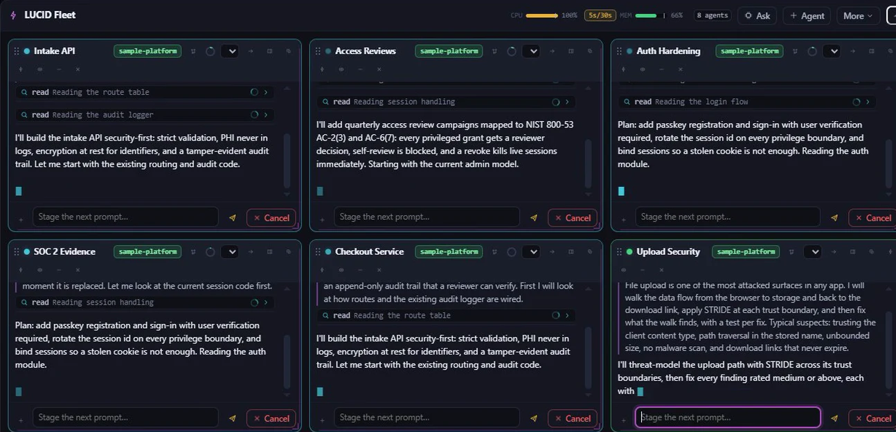
<br/><sub><b>A fleet of agents, each on its own task</b>, every one behind the same security gate</sub>
<br/><br/>
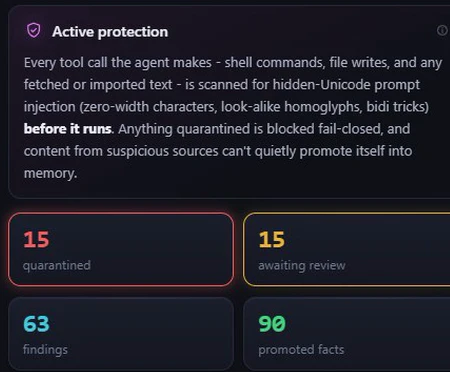
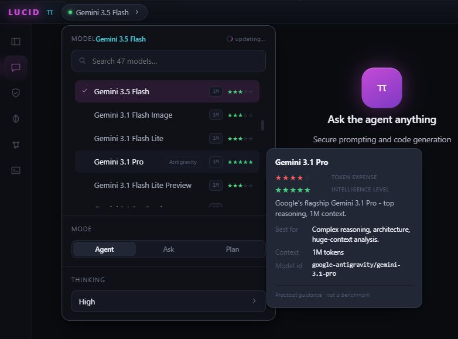
<br/><sub><b>Every tool call is checked before it runs</b> · <b>Pick any model your teams already use</b></sub>
<br/><br/>
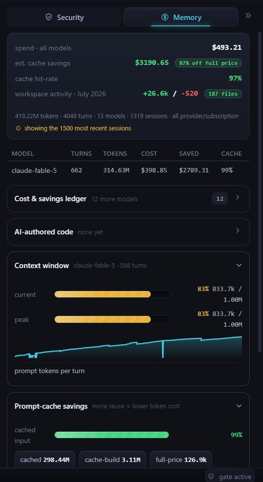
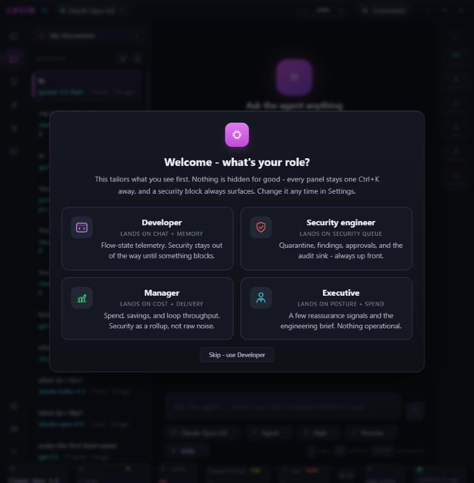
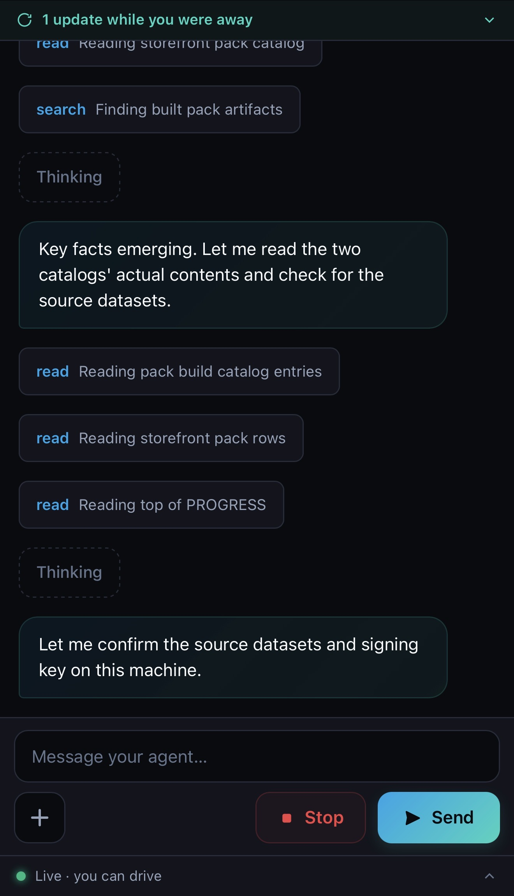

<br/><sub><b>Spend per model</b> · <b>A first view for each role</b> · <b>Your agent on your phone</b> · <b>Memory with a trust label on every fact</b></sub>
</div>

## New in v2.7: Agents you can see, schedule and keep light

**The short version for leadership.** One person can now keep several AI agents working side by side and see at a glance which ones are busy. Routine work, such as a nightly test run or a weekly report, can be scheduled to run on its own. LUCID itself now uses a small fraction of the computer it used before. Every agent still sits behind the same security gate, and that gate cannot fail open.

| What changed | Why it matters |
| :-- | :-- |
| **Agents on the right rail**: each project folder is a small Lucid that lights up while it works | You see who is working and who is idle without opening anything |
| **Schedule this Agent**: once, daily, weekdays, chosen days or monthly, with a goal in plain words | Routine work runs on time without anyone starting it |
| **Floating Agents** suggest the next step, ready to run in parallel or to ask about | Less time deciding what to do next, more work in parallel |
| **Ask Lucid** shows what it is doing while you wait, and answers with Claude Haiku 5.5 | Quick answers about your work without stopping the main agent |
| **Lighter and steadier**: an idle LUCID went from about 25% of the CPU to about 1%, and no git runs at startup | Laptops stay quiet, and the window keeps up with many agents at once |

<div align="center">
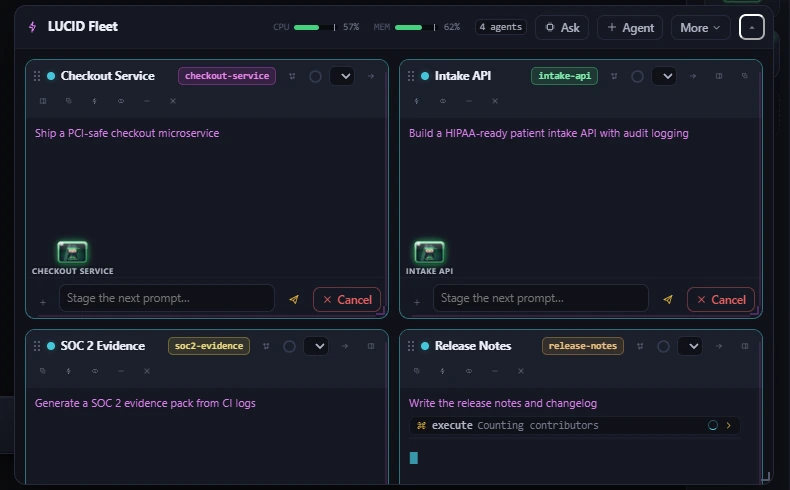
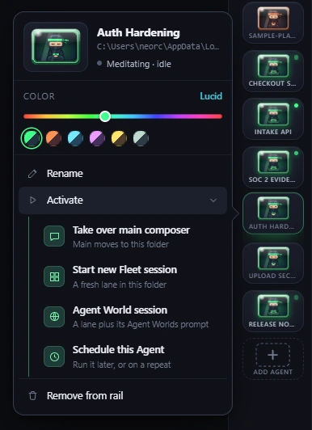
<br/><sub><b>Four agents at work</b> · <b>Each one lit on the rail; one click puts an Agent to work, or schedules it</b></sub>
<br/><br/>
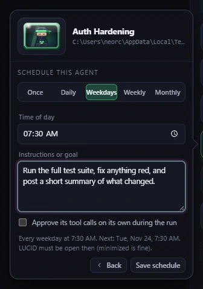
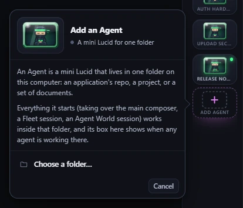
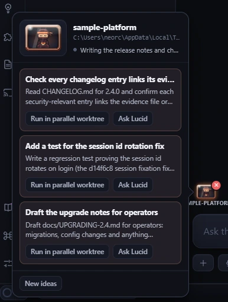
<br/><sub><b>Schedule work in plain words</b> · <b>Add an Agent in two steps</b> · <b>Next steps, ready to run</b></sub>
<br/><br/>
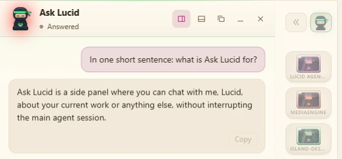
<br/><sub><b>Ask Lucid answers beside the rail without stopping the main agent</b></sub>
<br/><br/>
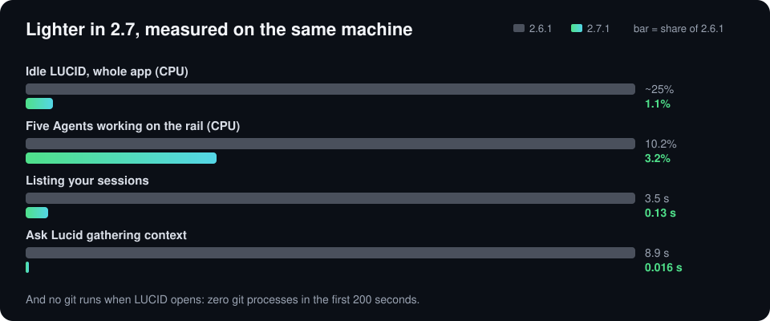
</div>

Also in 2.7:
- **World Packs** come first in the store.
- Worlds you bought restore themselves after an upgrade.
- One preview button now works the same in the composer, Fleet lanes and Agent Worlds.
- The Visualize view and the rail stay accurate when four or more agents run at once.

**v2.7.1 is the current stable release.** [Full release notes](https://github.com/mlcyclops/lucidagentide/releases/tag/v2.7.1).

## New in v2.6: Lucid Agent Worlds

<div align="center">

</div>

Visualize draws your AI agents as characters and their work as streams of light. A world turns that scene into a themed setting, so a team of agents reads like a game you can follow at a glance.

- **40 worlds**, from Christmas and Football to Hospital, Grand Prix, a carrier flight deck, Orbital Ops and Florida, each with a mixed cast whose skin and hair you choose.
- **Approve tool calls inside Visualize**: a badge appears over the agent that is asking, with Approve, Auto and Deny.
- **Sample games** in every world open only after LUCID's security check, with no internet and no access to LUCID.
- **Get them** one at a time or as a bundle at the **[LUCID store](https://store.lucid-agents.com)**, then install from **Preview > Plugins > Premium**.

Also in 2.6: a Windows sandbox that names exactly what it needs, a Fleet button that always brings your agents back, and a notice when a sign-in expires. [2.6.1 release notes](https://github.com/mlcyclops/lucidagentide/releases/tag/v2.6.1).

## Built for every seat at the table

| | You get | Guide |
| :-- | :-- | :-- |
| **Executives** | AI spend, authorship and risk you can report on | [Executive guide](docs/guides/executive-guide.md) |
| **Security** | A gate that blocks by default, findings and quarantines with evidence | [Security guide](docs/guides/security-guide.md) |
| **Managers** | Many agents at once, each on its own task, with approvals in one place | [Manager guide](docs/guides/manager-guide.md) |
| **Developers** | A full IDE with any model, where even Save is scanned | [Developer guide](docs/guides/developer-guide.md) |

## Install

| Platform | Download | Updates |
| :-- | :-- | :-- |
| **Windows** | [Installer](https://github.com/mlcyclops/lucidagentide/releases/latest/download/LucidAgent-Setup.exe) · [Portable](https://github.com/mlcyclops/lucidagentide/releases/latest/download/LucidAgent-portable.exe) | Built in. Installers are signed by TECHLEAD 187 LLC. |
| **macOS** | [Apple Silicon](https://github.com/mlcyclops/lucidagentide/releases/latest/download/LucidAgent-mac-arm64.pkg) · [Intel](https://github.com/mlcyclops/lucidagentide/releases/latest/download/LucidAgent-mac-x64.pkg) | Homebrew, below |
| **Linux** | [AppImage](https://github.com/mlcyclops/lucidagentide/releases/latest/download/LucidAgent-x86_64.AppImage) · [arm64](https://github.com/mlcyclops/lucidagentide/releases/latest/download/LucidAgent-arm64.AppImage) · [.deb and .rpm](https://github.com/mlcyclops/lucidagentide/releases/latest) | Install the new file over the old one |

Nothing else to install: every build bundles what it needs and works offline. On macOS, Homebrew installs and updates LUCID with no security prompt:

```bash
brew tap mlcyclops/lucid https://github.com/mlcyclops/lucidagentide
brew trust --cask mlcyclops/lucid/lucidagentide
brew install --cask lucidagentide
```

Updating keeps your settings, sessions and keys. Found a bug? **[Open an issue](https://github.com/mlcyclops/lucidagentide/issues/new?template=bug_report.yml)**; [Support](docs/SUPPORT.md) explains how to attach logs.

<details>
<summary><b>For developers: run from source</b></summary>

<br/>

LUCID is a security, provenance and memory layer built around [oh-my-pi](https://omp.sh) through its hooks, custom tools and SDK, never a fork. The harness is TypeScript on Bun; the only Python is the Unicode scanner sidecar.

```bash
bun install                       # harness deps (Bun >= 1.3)
cd scanner-sidecar && uv sync     # pinned Python sidecar venv
make test                         # full suite: harness + desktop + scanner sidecar
bun run demo-00                   # omp round-trip + scanner + fail-closed proof
```

Requires [Bun](https://bun.sh) and [uv](https://docs.astral.sh/uv/). Every increment ships with an ADR, tests and a runnable `make demo-<id>`.

| Doc | What's in it |
| :-- | :-- |
| [`CLAUDE.md`](CLAUDE.md) | The invariants every change must keep. Read first. |
| [`DECISIONS.md`](DECISIONS.md) | Architecture decision records |
| [`PROGRESS.md`](PROGRESS.md) | Build log: shipped, stubbed, next |
| [`CHEATSHEET.md`](CHEATSHEET.md) | Day-to-day commands |
| [`desktop/README.md`](desktop/README.md) | The desktop app and dev server |
| [`docs/MARKET-POSITIONING.md`](docs/MARKET-POSITIONING.md) | Where LUCID fits |

Contributions: open an issue or discussion before any large change so we can agree on scope and terms.

</details>

---

<div align="center">

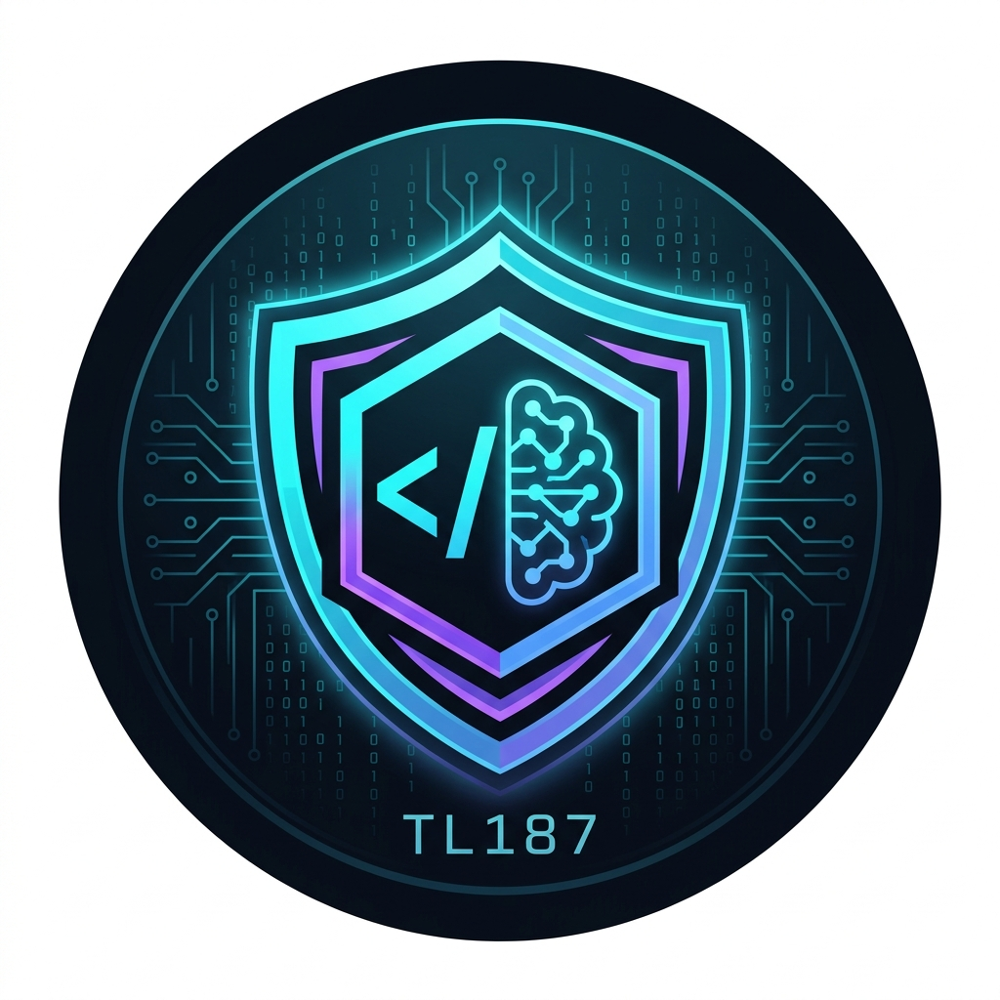

<sub>Built by <b>Nick Chadwick</b> · <a href="https://www.linkedin.com/in/nickchadwick-techlead187/">LinkedIn</a> · <a href="https://x.com/TechLead187">@TechLead187</a></sub><br/>
<sub>© 2026 TechLead 187 LLC · source-available under <a href="LICENSE">BUSL-1.1</a>, converting to MPL-2.0 on 2030-06-27</sub>

</div>
