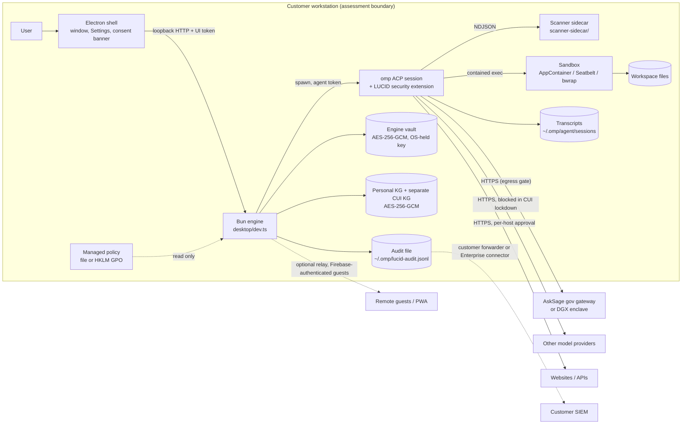

# LUCID Agent IDE: NIST SP 800-171 Rev 3 compliance package

For an assessor (or a customer's security officer) who has never seen LUCID Agent IDE. It describes what the product is, where Controlled Unclassified Information (CUI) can flow through it, which part of each requirement LUCID covers, and how to collect evidence.

Package contents:

| File | What it is |
| --- | --- |
| `control-matrix-r3.md` / `control-matrix-r3.csv` | Every SP 800-171 Rev 3 requirement (97 requirements plus the 33 withdrawn identifiers, 17 families) with the Rev 2 cross-reference, responsibility, LUCID implementation, how to verify, evidence and status. The CSV is the source; the Markdown is rendered from it. |
| `poam.md` | LUCID's known product gaps with risk, current mitigation and target increment. |
| `evidence-guide.md` | Per family, the exact commands and screens that produce evidence (PowerShell and bash). |
| `tools/compliance/evidence.ts` | Read-only CLI that writes `evidence.json` + `evidence.md` for the host it runs on. Also served at `GET /api/compliance/report`. |
| `.github/workflows/compliance-evidence.yml` | Release-time SBOM (CycloneDX), gitleaks secret scan, osv-scanner and the evidence report, uploaded as artifacts. |

## What LUCID Agent IDE is

A desktop agentic coding IDE built around oh-my-pi (`omp`), the coding-agent runtime, which LUCID runs unmodified as a child process. It is local-first: there is no LUCID cloud service, and the vendor operates nothing in the data path.

- **Electron shell** (`desktop/main.ts`, `desktop/renderer/`): the window, Settings, the consent banner, the approval dialogs.
- **Bun engine** (`desktop/dev.ts`, packaged as `bin/lucid-engine`): a loopback HTTP API used by the window, the omp children and optional paired controllers. Every route needs a token; the omp child's token opens only the routes listed in `AGENT_ROUTES`, a controller token only `CONTROLLER_ROUTES` (`desktop/origin_guard.ts`).
- **omp children** (ACP sessions): run the model loop and the tools. LUCID loads its security extension into every session (`harness/omp/security_extension.ts`): the fail-closed scan gate, exec and egress approvals.
- **Python scanner sidecar** (`scanner-sidecar/`): Unicode prompt-injection detection (zero-width, bidi controls, tag characters, private use, homoglyphs). A dead or failing scanner blocks the call (`harness/security/gate.ts`).
- **Sandbox**: agent shell commands run under Windows AppContainer (`tools/appcontainer/lucid_appcontainer.ts`), macOS Seatbelt or Linux bubblewrap, or a disclosed passthrough (`harness/runs/sandbox_exec.ts`).

## System boundary and data flows

The boundary for an assessment is the customer's workstation running LUCID plus whatever external services the customer allows. LUCID itself is the software inside that boundary.



## Where CUI can flow

| Place | What | Protection | Path |
| --- | --- | --- | --- |
| Prompts and model replies | Anything the user types or the agent reads | Leaves the host only to the configured model. Under CUI lockdown, only the AskSage gateway or an attested enclave host (`desktop/lockdown_route.ts`, `desktop/cui_policy.ts`). | Network |
| Workspace files | Source and documents the agent reads and edits | Sandbox folder grants (`desktop/sandbox_grants.ts`); disk encryption is the customer's. | The workspace |
| Transcripts | Full session history kept by omp | User profile; disk encryption is the customer's. | `~/.omp/agent/sessions/` |
| GUI turn records | Sanitized text plus a hash of the raw text | User profile (`desktop/turns_log.ts`). | `~/.omp/lucid-turns.jsonl` |
| Personal knowledge graph, CUI compartment | Facts the user files as CUI | Separate AES-256-GCM file with its own key and passphrase; the agent cannot write to it (`harness/personal/store.ts`, `harness/personal/agent_kg.ts`). | `lucid-cui.kg.enc` (see table below) |
| Audit log | Security decisions: metadata only, never content | User profile, append-only by code (`desktop/audit_export.ts`). | `~/.omp/lucid-audit.jsonl` |
| omp request dumps | Full prompt bodies of failed HTTP 400 requests | User profile. | `~/.omp/logs/http-400-requests/` |

## Shared responsibility

NIST SP 800-171 applies to the customer's system, not to a software product. LUCID provides capabilities (lockdown, sandbox, approvals, audit, encrypted stores, managed policy) and the evidence that they are on; the organization decides to use them, configures them, and covers everything outside the application (accounts, MFA, device lock, disk encryption, physical, personnel, training, incident response, SIEM). The matrix marks each requirement LUCID, shared, customer or n-a.

## Reference configuration for assessment

1. **Install** the signed Windows build (verify with `Get-AuthenticodeSignature`, see `evidence-guide.md`). macOS builds are unsigned (POA&M P-4).
2. **Managed policy.** An administrator writes `managed-config.json` to an admin-only location; LUCID only reads it and a managed value only ever tightens a setting (`desktop/managed_config.ts`).
   - Windows: `%ProgramData%\LucidAgentIDE\managed-config.json`, or the same JSON as a `Json` REG_SZ value under `HKLM\Software\Policies\LucidAgentIDE` (Intune / GPO). The file wins per setting when both exist.
   - macOS: `/Library/Application Support/LucidAgentIDE/managed-config.json`
   - Linux: `/etc/lucidagentide/managed-config.json` (ignored if group or world writable)
   - Any OS: `LUCID_MANAGED_CONFIG=<path>` set by the MDM.

   ```json
   {
     "orgName": "Example Corp",
     "models": { "asksageOnly": true, "lock": true },
     "security": {
       "exec": { "requireIsolation": true },
       "egress": { "disableDangerMode": true, "allowedHosts": ["<your AskSage gateway host>"], "lock": true },
       "sandbox": { "allowUserOff": false, "lockUserFolders": true }
     },
     "logging": { "enabled": true, "sink": "file" },
     "collab": { "allowServe": false },
     "updateChannel": "managed"
   }
   ```

   `models.asksageOnly` turns on CUI lockdown for everyone; while lockdown is on the window shows the DoD Notice and Consent banner once per launch (`desktop/renderer/app.ts` showDodBanner). `security.exec.requireIsolation` blocks agent shell commands when no sandbox is available. `security.egress.disableDangerMode` keeps allow-all off, so a host outside the allow list needs an explicit approval. Replace the `allowedHosts` placeholder with the hosts your gateway and tools actually use. `updateChannel: "managed"` turns off the in-app update check so IT controls the version.
3. **Egress whitelist.** Curate allowed hosts in Settings (stored in `~/.omp/lucid-whitelist.json`, `desktop/network_whitelist.ts`).
4. **Audit sink.** Keep `logging.enabled` true and forward `~/.omp/lucid-audit.jsonl` (OCSF JSON lines) with the organization's log forwarder. Direct SIEM connectors (Splunk, syslog, Elastic, cloud SIEMs) are in the Enterprise add-on.
5. **Sandbox.** On Windows the user controls the AppContainer sandbox from the Security panel; the managed `security.sandbox` block locks it on and fixes the folder grants, and `security.exec.requireIsolation` refuses agent commands when no sandbox backend is available.
6. **OS controls** the customer must supply: BitLocker / FileVault / LUKS, OS screen lock, MFA at sign-in, endpoint anti-malware.
7. **Collect evidence:** `bun run tools/compliance/evidence.ts --out <dir>` (or `make compliance-evidence`).

## Where to look

`~` is `%USERPROFILE%` on Windows. Paths with an environment variable can be moved by it.

| Item | Windows | macOS | Linux | Override |
| --- | --- | --- | --- | --- |
| Managed policy | `%ProgramData%\LucidAgentIDE\managed-config.json`; `HKLM\Software\Policies\LucidAgentIDE` | `/Library/Application Support/LucidAgentIDE/managed-config.json` | `/etc/lucidagentide/managed-config.json` | `LUCID_MANAGED_CONFIG` |
| GUI settings (no secrets when an OS vault is usable) | `~\.omp\lucid-gui.json` | `~/.omp/lucid-gui.json` | `~/.omp/lucid-gui.json` | `LUCID_GUI_SETTINGS_FILE` |
| Engine vault (provider keys, MCP tokens) | `~\.omp\lucid-engine-vault\secrets.v1.json` + `master.dpapi` (DPAPI, CurrentUser) | `~/.omp/lucid-engine-vault/secrets.v1.json`; key in Keychain service `LUCID Engine Vault` | `~/.omp/lucid-engine-vault/secrets.v1.json`; key in Secret Service `lucid-engine-vault` | `LUCID_ENGINE_VAULT_DIR` |
| Electron credential vault (whitelist auth, git PATs) | `~\.omp\lucid-cred-vault\` (safeStorage) | same under `~/.omp` | same under `~/.omp` | |
| omp OAuth logins | `~\.omp\agent\agent.db` | `~/.omp/agent/agent.db` | `~/.omp/agent/agent.db` | |
| Security audit (OCSF JSONL) | `~\.omp\lucid-audit.jsonl` | `~/.omp/lucid-audit.jsonl` | `~/.omp/lucid-audit.jsonl` | `LUCID_AUDIT_PATH` |
| Gate block ledger | `~\.omp\lucid-blocks.jsonl` | `~/.omp/lucid-blocks.jsonl` | `~/.omp/lucid-blocks.jsonl` | `LUCID_BLOCKS_PATH` |
| Telemetry events (EventName) | `~\.omp\lucid-events.ndjson` | `~/.omp/lucid-events.ndjson` | `~/.omp/lucid-events.ndjson` | |
| GUI turn records | `~\.omp\lucid-turns.jsonl` | `~/.omp/lucid-turns.jsonl` | `~/.omp/lucid-turns.jsonl` | |
| Transcripts | `~\.omp\agent\sessions\` | `~/.omp/agent/sessions/` | `~/.omp/agent/sessions/` | |
| Egress whitelist / remembered hosts | `~\.omp\lucid-whitelist.json`, `~\.omp\lucid-egress.json` | same under `~/.omp` | same under `~/.omp` | |
| Personal KG / CUI KG / KG export audit | `~\.omp\lucid-personal.kg.enc`, `lucid-cui.kg.enc`, `lucid-personal-audit.ndjson` | same under `~/.omp` | same under `~/.omp` | `LUCID_PERSONAL_DIR` |
| Sandbox temp (CUI lockdown) | `~\.omp\lucid-sandbox-tmp\` | `~/.omp/lucid-sandbox-tmp/` | `~/.omp/lucid-sandbox-tmp/` | |
| Engine log | `%APPDATA%\lucidagentide-desktop\engine.log` | `~/Library/Application Support/lucidagentide-desktop/engine.log` | `~/.config/lucidagentide-desktop/engine.log` | |
| omp logs, ACP log, failed-request dumps | `~\.omp\logs\`, `~\.omp\lucid-acp.log`, `~\.omp\logs\http-400-requests\` | same under `~/.omp` | same under `~/.omp` | |
| Installed app | `%LOCALAPPDATA%\Programs\LucidAgentIDE\LucidAgentIDE.exe` (per-user); `%ProgramFiles%\LucidAgentIDE\` (MSI, per-machine; electron-builder default, not yet observed on a host) | `/Applications/LucidAgentIDE.app` | AppImage / deb / rpm location | |

The Creator flavor and fleet profiles point `LUCID_GUI_SETTINGS_FILE` and `LUCID_PERSONAL_DIR` at their own data directory (`desktop/main.ts`), so check those variables when the defaults are empty.
